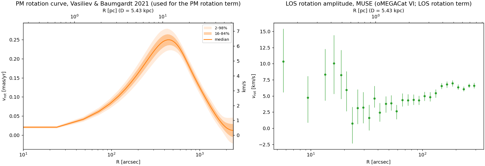
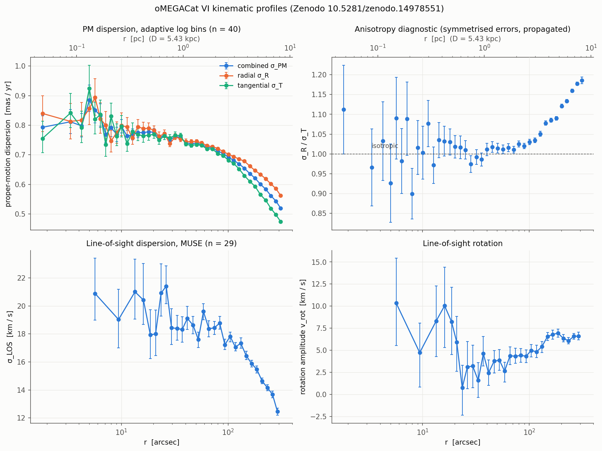
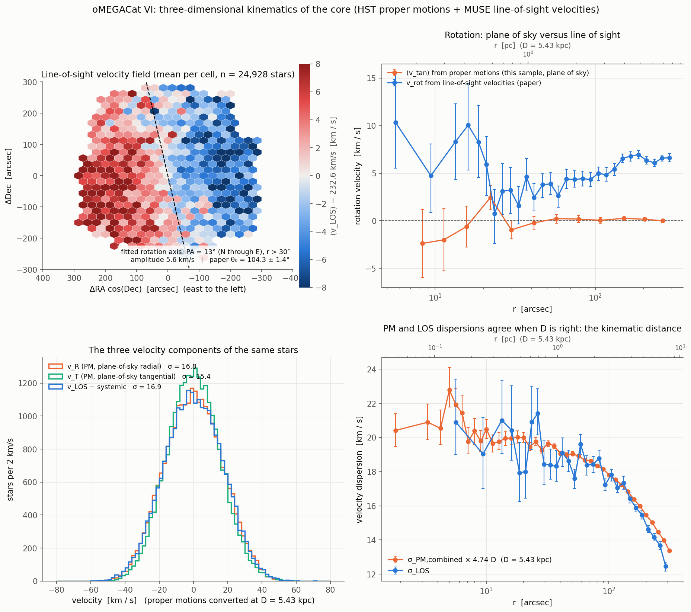
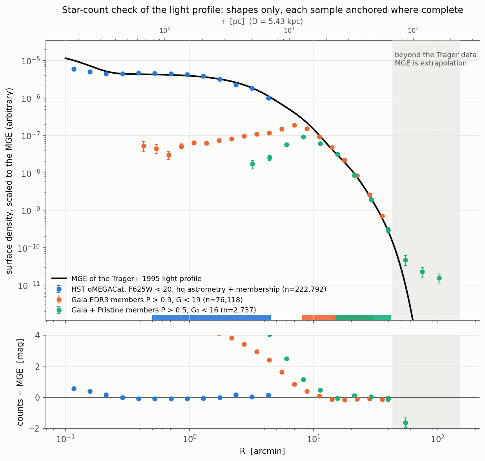
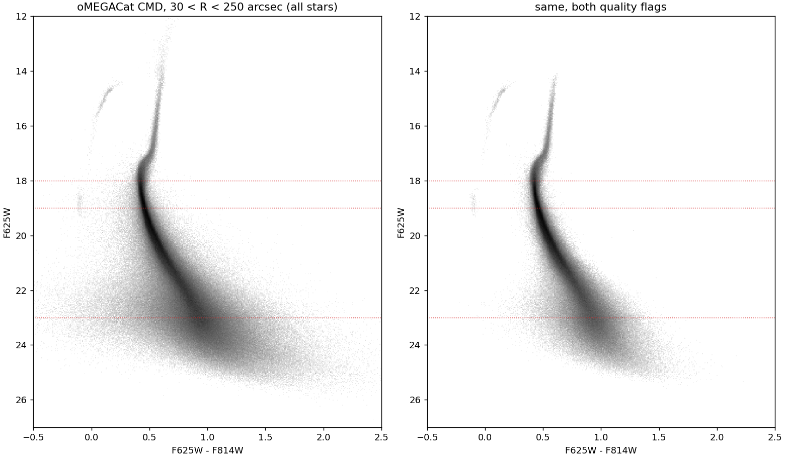
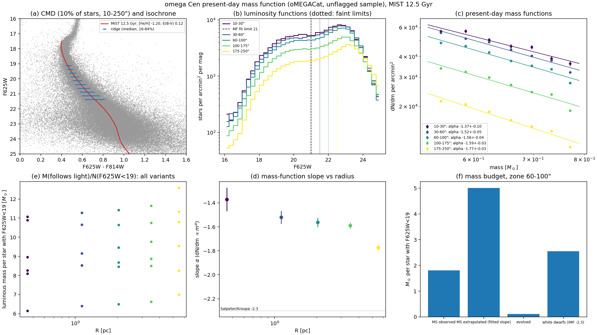

# Cluster kinematics, counts and light

Shorthands (`CAT`, `raw/`, `proc/`) are defined on the [Data products](index.md) page.

## Figures

All drawn from the current processed products (`bin/plot_data_products.py`, `ocen plot-data`, `bin/build_mass_function.py`).

*The 89 kinematic bins of the baseline fit (colour) and published profiles that are not fitted. Top: HST proper-motion dispersions, radial and tangential (ours, black; oMEGACat VI published, grey) continued outward by our Gaia EDR3 profiles (blue); dashed: the rotation term each fitted profile carries. Bottom left: MUSE line-of-sight dispersion with its rotation term (v_rot/√2). Bottom right: published one-dimensional Gaia proper-motion profiles (Vasiliev & Baumgardt 2021, Baumgardt+2019) against ours; the Vasiliev & Baumgardt profile lies below the HST values inside ~200″. Proper motions in mas/yr (right axis: km/s at 5.43 kpc).*

*Rotation used in the streaming correction. Left: Vasiliev & Baumgardt 2021 proper-motion rotation curve (median, 16–84% and 2–98%), peaking at 0.25 mas/yr (≈6.4 km/s) near 450″. Right: MUSE line-of-sight rotation amplitude (oMEGACat VI), rising from ~3 to ~7 km/s between 30″ and 300″.*

*The Poisson star-count products. Left: surface number density, HST F625W < 19 (2–250″, 117,751 stars) and Gaia G < 17 (300–2400″, 18,289 stars including field). Middle: stars per bin. Right: covered fraction of each annulus (≥ 0.995).*

*The published oMEGACat VI profiles: proper-motion dispersions (combined, radial, tangential), the σ_R/σ_T anisotropy diagnostic (isotropic inside ~100″, radially biased outside), MUSE line-of-sight dispersion and rotation.*

*Three-dimensional kinematics of the core from the same stars: line-of-sight velocity field with the fitted rotation axis; plane-of-sky versus line-of-sight rotation; the three velocity components; and proper-motion against line-of-sight dispersions, which agree at the adopted distance.*

*Shape of the light profile: the MGE of the Trager+1995 profile (used as the tracer of the earlier Jeans fits) against star counts from HST oMEGACat, Gaia EDR3 members and Gaia+Pristine members, each anchored where complete. Beyond the Trager data the MGE is an extrapolation.*

*oMEGACat colour–magnitude diagram, 30–250″, all stars (left) and with both quality flags (right). Dotted: F625W = 18 (turnoff), 19 (count-product limit) and 23 (luminosity-function turnover).*

*Present-day mass function from the unflagged oMEGACat sample with a MIST 12.5 Gyr isochrone: CMD and ridge line; luminosity functions in five radial zones; mass functions over 0.52–0.78 M☉ with slopes steepening outward (−1.37 to −1.77); the light-following mass per F625W < 19 star for each variant; and the budget in the 60–100″ zone (observed main sequence, extrapolation below 0.52 M☉, evolved stars, white dwarfs).*

## 0. How the baseline DF likelihood consumes its data

- **Driver.** `bin/run_compact_df_recovery.py`.
  - `prepare-real` (lines 229–263) copies `proc/kinematics/<count>.json` into the run directory and records each sha256 (lines 249–252).
  - It copies the kinematic `data_snapshot.json` from the `--start-from` source run.
  - It writes `problem.json`. The baseline record is `photometry: false, counts: [hst, gaia]`.
  - At run time, lines 63–72 verify the count sha256 and rebuild the `DFJointProblem`.
- **Frozen inputs.** `results/df/dftwo_counts_20260923/observed/`:

  | File | Size (B) |
  |---|---|
  | `data_snapshot.json` | 19,656 |
  | `ocen_counts_gaia_g17.json` | 3,226 |
  | `ocen_counts_hst_f625w19.json` | 5,411 |
  | `problem.json` | 717 |

  `batch.json` records `source_commit 36bca6f`, `gaia_error_floor_masyr 0.0` and `distance 5.43` (fixed in the starting config; free between 4.8 and 6.0 in coordinates).
- **Snapshot chain.** The `data_snapshot` comes from `results/df/pilot_no_dm_20260922`, whose `run.json` has `data_source = results/fits/rung2_K1_turnover`. The sha256 `570399f38ab2…` is identical in `rung1_K1_slice/summary.json` and `rung2_K1_turnover/summary.json`.
- **Gate output.** `report.json` lists χ² per point by dataset and the count deviance:

  | Dataset | χ²/pt | Count deviance / bin |
  |---|---|---|
  | hst_pm_radial_ours | 2.07 | |
  | hst_pm_tangential_ours | 1.95 | |
  | muse_los_dispersion | 1.31 | |
  | gaia_edr3_ours_radial | 1.55 | |
  | gaia_edr3_ours_tangential | 2.42 | |
  | ocen_counts_hst_f625w19 | | 4.94 |
  | ocen_counts_gaia_g17 | | 2.19 |

  These are start 0.
- **Default dataset list.** `src/ocen_dm/cli.py:364 DEFAULT_DATASETS` holds the same five kinematic keys.
  - The note at `cli.py:359–363` records why `gaia_edr3_pm` (published VB21 spline) was replaced on 2026-09-19.
  - It also records why `gaia_dr2_pm` was dropped on 2026-09-20.
- **Duplicate guard.** `likelihood.py:373 _FORBIDDEN_TOGETHER` refuses combinations that share stars, for example published plus "ours" HST, or VB21 plus our Gaia.

## K1. HST PM dispersion, our measurement (`hst_pm_radial_ours`, `hst_pm_tangential_ours`)

- **Source.** oMEGACat VI (Häberle et al. 2025, ApJ).
  - arXiv: https://arxiv.org/abs/2503.04903
  - DOI: https://doi.org/10.3847/1538-4357/adbe67
  - Data: https://doi.org/10.5281/zenodo.14978551
- **Raw file.** `raw/omegacat_vi_kinematics/catalog_and_selections.fits` (260,994,240 B). The published md5 `9de5a701…` was verified in `provenance/manifest.json`.
- **Builder.** `src/ocen_dm/kinematics/hst_profile.py`:
  - `load_hst_sample` (:112)
  - `hst_profile` (:170)
  - `build_hst_profile` (:221, writes :243)
  - `load_hst_product` (:248)
- **Selection.**
  - oMEGACat `selection_hq_astrometry > 0` (flagged stars only; `require_flag=True`, `correct_unflagged=False`).
  - Edges `DEFAULT_EDGES = geomspace(2, 250, 21) ∪ [300, 340, 360]` arcsec (:101), giving 21 bins (r_median 3.65–341.5″).
  - Each bin is fitted as a cluster 2-D Gaussian plus a field mixture, using the **K8** field template in absolute PM.
- **Product.** `proc/kinematics/ocen_pm_dispersion_hst_ours.ecsv` (10,949 B; built 2026-09-20T08:46Z).
  - Columns: `r_lower/r_median/r_upper` [arcsec], `n_stars`, `n_flagged`, `f_unflagged`, `f_field`, `sigma_pmr(_err)`, `sigma_pmt(_err)`, `sigma_pm(_err)` [mas/yr], `sigma_raw`, `sigma_sys`, `sigma_kms(_err)`, `r_pc`, `r_node0..7`.
  - Metadata: `unflagged_bias (1.077, 0.011)` is recorded but not applied.
- **Likelihood use.** `likelihood.py:275 _hst_ours`.
  - Errors are symmetric.
  - The tangential component adds ⟨μ_T⟩² from the K5 rotation curve as `streaming2`. The rotation-curve error is propagated in quadrature (`streaming_error_on_sigma`, :153).
  - `r_nodes` gives star-weighted radial averaging.
- **Restrictions.**
  - Metadata note: HST PMs are locally corrected, so the dispersion is about a rotation-free mean.
  - Shares stars with K7, so the two cannot be combined (`_FORBIDDEN_TOGETHER`).
- **Status.** a, b (Jeans rung0/1/2). The loader auto-builds the product if it is missing, per the README.

## K2/K3. MUSE LOS dispersion and LOS rotation

- **Source.** oMEGACat VI, as for K1.
- **Raw file.** `raw/omegacat_vi_kinematics/los_profile.fits` (17,280 B; md5 verified). The `.dat` twin (4,237 B) is unused.
- **Builder.** `src/ocen_dm/data/omegacat.py:257 preprocess` (CLI `ocen preprocess --dataset omegacat`, `cli.py:82`). The configuration is in `configs/data.yaml` `omegacat_vi.products`.
- **Products.**
  - `proc/kinematics/omegacat_vi_los_dispersion.ecsv` (29 rows). r_median 5.66–290.3″ (edges 0–332.3″). Columns `sigma_los`, `sigma_los_err_lo/hi` [km/s], plus `src_*` copies.
  - `proc/kinematics/omegacat_vi_los_rotation.ecsv` (29 rows). Columns `v_rot`, `v_rot_err_lo/hi` [km/s], `theta_0` [deg].
- **Likelihood use.** `likelihood.py:172–203`.
  - The two-piece Gaussian handles the asymmetric errors.
  - `streaming2 = v_rot²/2` (:182–186), with a check that the bins are identical.
  - No rotation error is propagated for MUSE (module docstring).
- **Metadata rule** (`ocen_likelihood_rule`): "binned profile: compare a model integrated over the same radial bin and tracer selection; bins share stars with other binnings of the same data, so alternative binnings are not independent likelihood factors".
- **Status.** a, b.

## K4. Gaia EDR3 PM dispersion, our measurement (`gaia_edr3_ours_radial`, `gaia_edr3_ours_tangential`)

- **Source.** Vasiliev & Baumgardt (2021), MNRAS 505, 5978.
  - arXiv: https://arxiv.org/abs/2102.09568
  - DOI: https://doi.org/10.1093/mnras/stab1475
  - Data: https://doi.org/10.5281/zenodo.4891252
- **Input.** K6 member catalogue.
- **Builder.** `src/ocen_dm/kinematics/outer_gaia.py:61 build_edr3_profile`; `load_edr3_profile` (:141) auto-builds if missing.
- **Selection.**
  - Quality bit 2 (`QUALITY_BIT`).
  - Mean PM error < 0.4 × the published σ(R). That σ(R) comes from K5 through `vb2021_replication.published_profile`.
  - Edges `[300, 380] ∪ geomspace(460, 2400, 8)` arcsec give 9 bins (r_median 357–2149″). Bins with fewer than 25 stars are skipped.
  - Per bin: the K8 field template matched to the bin's error ceiling and G range; exact perspective correction; depth dispersion from the composite tracer L2 (`_composite_tracer`, :56).
  - Membership probability is **not** used as a weight.
- **Product.** `proc/kinematics/ocen_pm_dispersion_edr3_ours.ecsv` (7,735 B; built 2026-10-11T07:11Z, with values identical to the 2026-09-23 snapshot).
  - Raw-error columns: `sigma_pmr(_err)`, `sigma_pmt(_err)`.
  - Eta-inflated alternatives: `sigma_*_eta(_err)`.
  - Also `mean_pmr`, `mean_pmt`, `streaming2`, `f_field`, `median_eta`, `median_g`, `r_node0..7`.
  - Metadata note: `sigma_sys` (half the raw/eta gap) is **not** added to the errors.
- **Likelihood use.** `likelihood.py:308`. Defaults: `error_model="raw"` and `rotation="published"` (the K5 curve with its percentile error). The variant `rotation="ours"` uses the fitted mean motion instead.
- **Restrictions.** Shares stars with K5, K9 and the combined key `gaia_edr3_ours` (forbidden together).
- **Status.** a, b.

## K5. Vasiliev & Baumgardt 2021 PM dispersion and rotation profiles

- **Raw file.** `$OCEN_CATALOGUES/vasiliev_baumgardt_2021_clusters.zip` (118,940,646 B). This is outside the repo. The published md5 `3a07093b…` is recorded as verified. The product reads the member `profiles/NGC_5139_oCen.txt`.
- **Builder.** `src/ocen_dm/data/vasiliev2021.py:146 load_profiles` and `:171 preprocess`.
- **Product.** `proc/kinematics/vasiliev2021_ocen_pm_profiles.ecsv` (101 rows, r 0–2400″).
  - Columns: `sigma_pm_p02..p98`, `vrot_pm_p02..p98` [mas/yr], `undocumented_col12` (meaning unknown; absent from the readme).
  - The source r is in degrees and is converted to arcsec.
- **Consumers.**
  - `likelihood.pm_rotation_curve` (:123) and `pm_rotation_error` (:137): streaming term for K1 tangential and K4 tangential (a*).
  - `_vasiliev2021` (:220, key `gaia_edr3_pm`, thinned to 8 points): legacy Jeans runs such as `results/fits/K1_noDM_composite` (h).
  - `vb2021_replication.published_profile` (:66): K4 error cut.
  - `plotting/constraints.py`.
- **Metadata rule.** "authors' binned PM profiles from the same stars as the member catalogue: not independent of a likelihood built on those stars".

## K6. Vasiliev & Baumgardt 2021 member catalogue (ω Cen)

- **Raw file.** `CAT/gc_members_gaia_vasiliev.fits` (222,621,120 B; sha256 `a75b33ca…`). This is the user's FITS compilation of the zip. Its ω Cen block was checked against `catalogues/NGC_5139_oCen.txt`; details in `datasets.yaml`.
- **Builder.** `src/ocen_dm/data/vasiliev2021.py:131 load` and `:171 preprocess`. All 228,055 rows are kept with no probability cut (2,343,282 rows in the file).
- **Product.** `proc/tails/vasiliev2021_ocen_members.ecsv` (31,197,357 B).
  - Columns: `source_id`, `ra`, `dec`, `x`, `y` [deg], `parallax(_error)` [mas], `pmra`, `pmdec(_error)` [mas/yr], `pmra_pmdec_corr`, `g_mag`, `bp_rp`, `source_density` [arcmin⁻²], `quality_flag` (bit 0: 5-parameter solution; bit 1: passed quality filters), `membership_prob`.
- **Metadata rule.** "astrometric membership probability: use as a stated selection threshold that belongs to the selection function, not as a per-star likelihood weight".
- **Consumers.**
  - `outer_profile.load_members` (:121) → K4, K8 (the μ_sys estimate)
  - `bin/build_count_profiles.py:112` → C2
  - `selection/hst_gaia_match.py:53` → K10
  - `cluster.centre("vasiliev")`
  - `vb2021_replication`
  - plots
- **Status.** a*.

## K7. oMEGACat VI published PM profiles (`hst_pm_radial`, `hst_pm_tangential`, `hst_pm_combined`)

- **Raw file.** `raw/omegacat_vi_kinematics/proper_motion_dispersion_log_bins.fits` (17,280 B, HDU 1).
- **Builder.** `data/omegacat.py:257`.
- **Products.** `proc/kinematics/omegacat_vi_pm_{radial,tangential,combined}.ecsv`, 40 rows each, r_median 1.8–311″ (edges to 346″). Columns `sigma_pm{r,t,c}`, `_err_lo/_hi` [mas/yr], plus `src_anisotropy`.
- **Consumers.**
  - `likelihood.py:360–362`.
  - Presets `watkins2013` (radial and tangential) and `omegacat6`, `baumgardt2018`, `imbh_limit` in `kinematics/presets.py:51–93`.
  - Older Jeans runs (`results/fits/preset_*`, `K1_noDM_composite`).
  - Plots.
- **Restriction.** `configs/data.yaml` notes that the three profiles come from one file, so they share bins and stars. Radial, tangential and combined are not independent, and `hst_pm_combined` is forbidden with the other two.
- **Status.** b (literature presets only), h, d. They are superseded in the baseline by K1, which reaches 360″ against the published 300″.

## K8. Gaia DR3 field template

- **Source.** WSDB `gaia_dr3.gaia_source`.
  - Query in `selection/field_template.py:35`: q3c annulus 0.75–1.6° about (201.69683, −47.47957), G < 20.5, non-null PM.
  - Fetched 2026-09-20T08:36Z: 267,966 fetched, 231,269 kept.
- **Builder.** `selection/field_template.py:66 build_product` (CLI `ocen fetch-field-template`, `cli.py:417`, `:499`).
- **Cuts.** RUWE < 1.4, astrometric excess noise < 1, mean PM error < 1.5 mas/yr. No parallax cut since 2026-09-20.
- **Frame.** Systemic 3-D velocity projected star by star, with μ_sys taken from K6 ((−3.2514, −6.7444) mas/yr) and v_los = 232.6 km/s.
- **Product.** `proc/kinematics/ocen_field_template_dr3.ecsv` (35,323,170 B).
  - Columns: `r_arcsec`, `sys_a`, `sys_d`, `mu_a`, `mu_d`, `mu_r`, `mu_t`, `pm_error`, `g_mag`.
  - Surface density 10.24 arcmin⁻².
- **Consumers.** `field_density_2d` / `field_kde` in K1 and K4 (a*); `pristine_profile.py`; `plotting/constraints.py`.

## K9. Gaia DR2 PM dispersion (Baumgardt et al. 2019)

- **Source.** MNRAS 482, 5138; DOI 10.1093/mnras/sty2997 (`verified: false`, from the VizieR record). VizieR `J/MNRAS/482/5138/table4`.
- **Raw file.** `raw/baumgardt2019_pm_profiles/baumgardt2019_table4.vot` (38,671 B; 319 rows, 9 for NGC 5139).
- **Builder.** `data/baumgardt2019.py:71`.
- **Product.** `proc/kinematics/baumgardt2019_ocen_pm_dispersion.ecsv` (9 rows, r 179–1747″). Columns `sigma_pm`, `sigma_pm_err_hi/lo` [mas/yr], `n_stars`.
- **Likelihood use.** Key `gaia_dr2_pm` (`likelihood.py:205`), with the note that it is ASSUMED to be a 1-D dispersion with no rotation term.
- **Metadata rule.** "binned DR2 PM dispersion; stars overlap the EDR3 member sample and the Kuzma 2025 members -- not independent".
- **Status.** h (dropped from the defaults on 2026-09-20, `cli.py:361`); used by `preset baumgardt2018` and in plots.

## K10. HST–Gaia PM cross-match

- **Builder.** `selection/hst_gaia_match.py:36 build_match` (tolerance 0.06″, epoch offset fitted).
- **Product.** `proc/kinematics/hst_gaia_pm_match.ecsv` (1,554,184 B, 8,064 rows; built 2026-09-19).
- **Metadata note.** HST PMs are relative, so only differences and dispersions are comparable.
- **Consumers.** `plotting/constraints.py:936,1014`.
- **Status.** d.
- **Caveat.** The project journal (2026-10-08) flags that its `hst_quality` column (`hst_gaia_match.py:72`) uses `selection_hq_astrometry_and_membership`, which contains a CMD cut. This was flagged in JOURNAL and left unchanged.

## C1/C2. Poisson count profiles

- **Builder.** `bin/build_count_profiles.py` (`hst_counts` :71, `gaia_counts` :112, `build` :132, `main` :149). The likelihood is in `kinematics/counts.py` (`CountProfile`; schema 1/2 handling in `to_dict`/`from_dict`, :174–195).

**C1, HST (`ocen_counts_hst_f625w19`).**
- **Input.** `raw/omegacat_vi_kinematics/catalog_and_selections.fits`.
- **Selection.** All stars with measured F625W < 19 and **no quality flag** (139,498 stars).
- **Binning and coverage.** Centre pixel (15000, 15000) at 0.04″/px. 20 log bins from 2 to 250″. Coverage from the occupancy of 3″ cells, set to 1 inside 30″.
- **Field term.** `fit_field=False`.
- **Rationale** (metadata note). The hq flag is 12–15 % radially incomplete; N(<20)/N(<19) = 2.0–2.1 at all radii; the field is below 0.5 % at 250″.

**C2, Gaia (`ocen_counts_gaia_g17`).**
- **Input.** K6.
- **Selection.** All stars with G < 17, members plus field (24,695 stars).
- **Binning.** 12 full annuli from 300 to 2400″.
- **Field term.** `fit_field=True` (a uniform field density is fitted).

**Files** (both in `proc/kinematics/`):

| File | Size (B) | Notes |
|---|---|---|
| `ocen_counts_hst_f625w19.ecsv` | 3,870 | schema 2 |
| `ocen_counts_hst_f625w19.json` | 9,132 | schema 2, contains `node_weights` |
| `ocen_counts_gaia_g17.ecsv` | 2,292 | schema 2 |
| `ocen_counts_gaia_g17.json` | 5,368 | schema 2 |
| `ocen_counts_*_schema1_20260923.{ecsv,json}` | — | used by the baseline (sha256 match) |

- **ECSV columns.** `r_lower`, `r_upper`, `r_median`, `n_stars`, `coverage`, `area_arcsec2`, `density_per_arcmin2`, `poisson_err_per_arcmin2`.
- **Consumers.** `run_compact_df_recovery.py` with `--counts` (baseline; `rho20scan_*`; `mpsscan_*`; mocks). Plots: `bin/plot_count_profiles.py:38`, `plot_halo_compensation.py`, `plot_mass_per_star_profile.py`, `plot_remnant_halo_degeneracy.py`, `plot_mock_mass_per_star.py`.
- **Likelihood note** (`counts.py` docstring). Schema-1 products are "read for replay only" because their mean is star-weighted, biased high by about 3 % per bin for Σ ∝ R⁻². The baseline and all 2026-09-23 scans used schema 1.
- **Status.** a.

## L1. Trager, King & Djorgovski 1995 surface-brightness profile

- **Source.** AJ 109, 218; ADS https://ui.adsabs.harvard.edu/abs/1995AJ....109..218T (`verified: false`). VizieR `J/AJ/109/218/tables`.
- **Raw file.** `raw/trager1995_sbp/trager1995_tables.vot` (2,102,164 B; 17,148 rows).
- **Builder.** `data/trager1995.py:87`. Rows are filtered to `ngc5139` (73 rows) and r = 10^logr.
- **Product.** `proc/literature/trager1995_ocen_sbp.ecsv`. r 10.5–2588″; columns `mu_v`, `mu_v_fit`, `residual` [mag arcsec⁻²], `weight`, `data_set`.
- **Metadata rule.** "surface-brightness SHAPE only: the M/L nuisance parameter absorbs the zero-point; heterogeneous data sets -- use the authors' weights".
- **Consumers.** `light_model.load_trager_profile` (:85) → L2; Jeans `--tracer trager` (preset `watkins2013`).

## L2. Composite tracer profile (not a stored product)

- **What it is.** `light_model.composite_profile` (:131) / `load_tracer_profile("composite")` (:165).
  - Inside 25″: oMEGACat star counts with `selection_hq_f625w` and F625W < 19 (`star_count_profile`, :98).
  - Outside: Trager, with the zero point anchored over 30–100″ using Trager points of weight ≥ 0.5.
- **Consumers.**
  - Jeans fits: `kinematics/fit.py`; tracer `composite` in rung0/1/2.
  - K4 depth term (`outer_gaia.py:56`).
  - DF runs without counts. Example: `dftwo_20260923` uses `photometry.json`, which came from `PhotometricData.from_relative_weights(load_tracer_profile("composite"))` in `bin/run_df_pilot.py:101`.
  - `tails/dm_density_plots.py`.
- **Note.** L2 uses the hq flag, while C1 deliberately does not.

## L3. Baumgardt GC database parameters

- **Raw file.** `CAT/gc_catalog_updated.fits` (57,600 B; mtime 2025-05-16). The upstream version is not recorded, so the product is **UNVERIFIED** against the live database (https://people.smp.uq.edu.au/HolgerBaumgardt/globular/).
- **Builder.** `data/baumgardt_catalogue.py:76`.
- **Product.** `proc/literature/baumgardt_ocen_parameters.ecsv` (1 row: PM, distance, RV, mass, r_h, r_c, orbit, [Fe/H] and others).
- **Metadata rule.** "use as priors and cross-checks, not as data in the likelihood".
- **Consumers.** `plotting/data_overview.py` only.
- **Systemic values are defined elsewhere.** `cluster.py` is the single reference for omega Cen's position, motion and distance (since 2026-10-16), each value with its published source:
  - centre: oMEGACat / Anderson & van der Marel 2010;
  - systemic PM (−3.250, −6.746) ± 0.022 mas/yr: Vasiliev & Baumgardt 2021, Table A1 (the earlier (−3.257, −6.730), labelled with that paper, matched no source);
  - v_los 232.7 ± 0.2 km/s: Baumgardt & Hilker 2018;
  - distance 5.43 ± 0.05 kpc: Baumgardt & Vasiliev 2021.
  - These are the values the oMEGACat papers adopt. `tests/test_cluster_reference.py` fails if any of them is typed in anywhere else in `src/` or `bin/`.
- **Status.** d.

## M1. Present-day mass function and mass per counted star (M/N19)

- **Inputs.**
  - oMEGACat `catalog_and_selections.fits`: unflagged stars with F625W and F814W in zones 10–30–60–100–175–250″, with a common fit limit F625W < 21.0.
  - MIST v1.2 bolometric-correction tables, through minimint 0.5.1. `HST_ACSWF.txz` and `HST_WFC3.txz` were downloaded from waps.cfa.harvard.edu/MIST/BC_tables/v1/ and prepared into the prefix `$OCEN_ISOCHRONES/minimint_hst/`. That directory exists (241 MB; 70 filter files plus symlinks to the base grid). See the project journal.
- **Builder.** `bin/build_mass_function.py`:
  - isochrone `minimint.Interpolator(["ACS_WFC_F625W", "ACS_WFC_F814W"])` at line 82;
  - 12.5 Gyr, D = 5.43 kpc, E(B−V) = 0.12;
  - [Fe/H] from the ridge-line fit (adopted −1.20) or forced to `--feh -1.53`.
- **Products.**
  - `results/mass_function/mass_function_20260923.json` (9,262 B).
  - `results/mass_function/mass_function_feh153_20260923.json` (9,275 B).
  - Keys: `age_gyr`, `feh_adopted`, `ridge_fits`, `dm0`, `a625`/`a814`, `m_turnoff`, `zones` and others.
  - Plot: `plots/mass_function_*.png`.
- **Result** (the project journal). M/N19 = 8.4–9.5 M☉ per star in the kinematically dominant zones.
- **Use.** An external prior. `bin/run_mass_per_star_scan.sh` pins the HST count amplitude with `--mass-per-star ocen_counts_hst_f625w19=M` for M = 7–12, writing `results/df/mpsscan_*`, `mpsmock_*` and related plots. It is not part of the baseline.
- **Provenance gap.** Not in `datasets.yaml`. The MIST citation and URL appear only in the project journal.

## O1. Unused oMEGACat VI files

- **Location.** `raw/omegacat_vi_kinematics/` (all md5-verified).
- **Files:**
  - `proper_motion_dispersion_{lin,equaln,voronoi}_bins.{fits,dat}`
  - `los_dispersion_and_rotation_voronoi_bins.{fits,dat}`
  - `energy_equipartition_{profiles,massbins}.{fits,dat}`
  - `catalog_and_selections.dat` (250,605,025 B; duplicates the FITS)
  - `data_products_demonstration_and_test.ipynb`
- **Status.** e. They are listed in `data/omegacat.py:55 PRODUCT_FILES`. `configs/data.yaml` says that "fitting more than one binning of the same data would double-count it".
