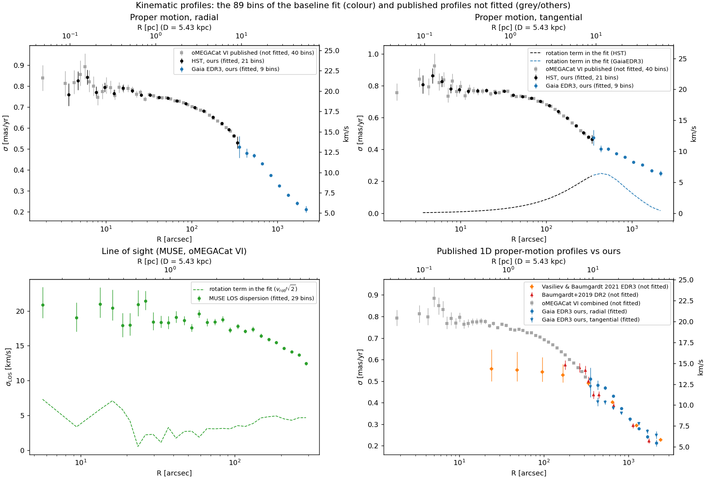
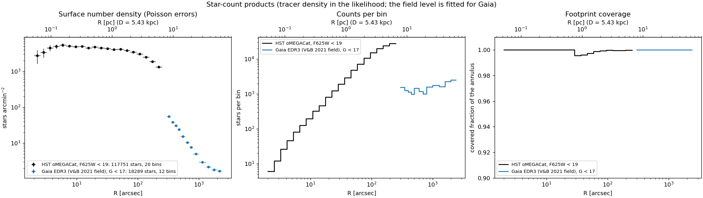

# Data products

Every dataset the project uses: where it comes from, how it is processed, what consumes it and whether it enters the baseline fit.

!!! note "Provenance of this page"
    Compiled on 2026-10-13 from the code, `provenance/`, `configs/data.yaml` and the project journal, with file sizes checked on disk. Paths to `data/` and `results/` are local (not committed). Anything without a recorded source is marked **UNVERIFIED**.

## At a glance

*The kinematic profiles of the baseline fit and the published profiles not fitted; details and the other figures on [Cluster kinematics, counts and light](cluster.md) and [Periphery, tails and streams](tails_streams.md).*

*The two star-count products.*

## Where things live

| Shorthand | Path |
|---|---|
| `CAT` | `$OCEN_CATALOGUES` (the canonical store) |
| `OB` | `$OCEN_BAR_DIR`. |
| `raw/` | `data/raw` |
| `proc/` | `data/processed` |

All sizes are from `ls` on 2026-10-13. Sources are quoted only as they appear in `provenance/datasets.yaml`, `configs/data.yaml`, code docstrings, `PROVENANCE`/`README` files or the project journal. Anything with no recorded source is marked **UNVERIFIED**.

## Key facts

- **Baseline inputs.** The current baseline DF likelihood is `results/df/dftwo_counts_20260923`. It uses:
  - five kinematic profiles: `hst_pm_radial_ours`, `hst_pm_tangential_ours`, `muse_los_dispersion`, `gaia_edr3_ours_radial`, `gaia_edr3_ours_tangential` (89 bins in total);
  - two Poisson count profiles: `ocen_counts_hst_f625w19` (20 bins) and `ocen_counts_gaia_g17` (12 bins).

  The kinematics are frozen in `observed/data_snapshot.json` (sha256 `570399f3…`). That snapshot was copied from `results/df/pilot_no_dm_20260922`, which took it from the Jeans run `results/fits/rung2_K1_turnover`. The rung-1 and rung-2 Jeans ladder runs carry the identical snapshot sha.
- **Products reproduce the baseline.** I reloaded the five profiles today through `ocen_dm.kinematics.likelihood.load_profile`. Values and errors match the frozen snapshot exactly (max |Δ|/σ = 0). This holds even though `ocen_pm_dispersion_edr3_ours.ecsv` was rebuilt on 2026-10-11.
- **Count products have moved on.** The baseline used **schema-1** count files (star-weighted quantile nodes). Their sha256 values match `proc/kinematics/ocen_counts_*_schema1_20260923.json`. The files `proc/kinematics/ocen_counts_*.json` now hold **schema 2** (area-weighted covered-area quadrature, commit 1af8c33). A rerun with the current products would therefore not reproduce the baseline count deviance.
- **Indirect baseline inputs.** Several products feed the baseline without being likelihood terms themselves:

  | Product | How it reaches the baseline |
  |---|---|
  | Vasiliev & Baumgardt (2021) PM profiles | PM rotation curve used for the tangential streaming subtraction and its error |
  | oMEGACat LOS rotation | MUSE streaming term |
  | Gaia DR3 field template from WSDB | Used by both of our own PM-dispersion builders |
  | Composite tracer profile (Trager 1995 plus oMEGACat `selection_hq_f625w` star counts) | Gaia depth-dispersion correction |
  | Vasiliev & Baumgardt member catalogue | Parent sample for the Gaia PMs and the Gaia counts |
  | oMEGACat star catalogue | Parent sample for the HST PMs and the HST counts |

- **Main gaps.** Detailed in Section 3:
  - The registry (`provenance/datasets.yaml`) covers only the September kinematics/tails datasets. All stream-project inputs are registered only in `configs/data.yaml` or the project journal, or not at all: STREAMFINDER 2021/2024, HST LP, the Tango Zenodo archive, Hunter+2024 potentials, `gc_catalog_full.fits` and Gaia XP pulls.
  - Several WSDB caches that every stream fit depends on have no builder script.
  - `manifest.json` and `checksums.txt` contain stale entries.

## Summary table

**Columns.**

| Column | Meaning |
|---|---|
| id | Short key used in this document. |
| Source | Paper or catalogue. |
| Builder | Code that writes the product. |
| Product | Processed or derived file. |
| Used by | Main consumers. |
| Status | One or more of the codes below. |

**Status codes.**

| Code | Meaning |
|---|---|
| a | Enters the baseline DF likelihood (`dftwo_counts_20260923`). `a*` means it enters indirectly, through a builder or a streaming term. |
| b | Used in the Jeans ladder fits. |
| c | Used by the stream/tails sub-project. |
| d | Diagnostic or plots only. |
| e | Registered or present but unused. |
| h | Historical: used by older runs or presets only. |

### 1.1 Kinematics, counts and light

| id | Source | Builder | Product | Used by | Status |
|---|---|---|---|---|---|
| K1 hst_pm_*_ours | oMEGACat VI catalogue, Zenodo 14978551 | `kinematics/hst_profile.py:221 build_hst_profile` | `proc/kinematics/ocen_pm_dispersion_hst_ours.ecsv` | `likelihood.py:275 _hst_ours`, DF baseline, Jeans rung0–2 | a, b |
| K2 muse_los_dispersion | oMEGACat VI `los_profile.fits` | `data/omegacat.py:257 preprocess` | `proc/kinematics/omegacat_vi_los_dispersion.ecsv` | `likelihood.py:172 _omegacat` | a, b |
| K3 MUSE LOS rotation | same file | same | `proc/kinematics/omegacat_vi_los_rotation.ecsv` | `likelihood.py:182` (streaming² = v_rot²/2) | a*, b |
| K4 gaia_edr3_ours_{radial,tangential} | Vasiliev & Baumgardt 2021 members | `kinematics/outer_gaia.py:61 build_edr3_profile` | `proc/kinematics/ocen_pm_dispersion_edr3_ours.ecsv` | `likelihood.py:308 _edr3_ours_component` | a, b |
| K5 VB21 PM profiles (rotation curve) | VB21 Zenodo 4891252 `clusters.zip` `profiles/NGC_5139_oCen.txt` | `data/vasiliev2021.py:171 preprocess` | `proc/kinematics/vasiliev2021_ocen_pm_profiles.ecsv` | `likelihood.py:123/137` rotation and its error; `gaia_edr3_pm` key; `outer_gaia` pilot σ(R) | a*, b, h |
| K6 VB21 member catalogue | Zenodo 4891252, via the user FITS `CAT/gc_members_gaia_vasiliev.fits` | `data/vasiliev2021.py:171` | `proc/tails/vasiliev2021_ocen_members.ecsv` (228,055 rows) | K4, C2, K10, `cluster.py`, plots | a* |
| K7 oMEGACat VI PM profiles (published) | Zenodo 14978551, `proper_motion_dispersion_log_bins.fits` | `data/omegacat.py:257` | `proc/kinematics/omegacat_vi_pm_{radial,tangential,combined}.ecsv` | Keys `hst_pm_radial/tangential/combined` | b (presets), h, d |
| K8 Gaia DR3 field template | WSDB `gaia_dr3.gaia_source` | `selection/field_template.py:66` (CLI `fetch-field-template`, `cli.py:417`) | `proc/kinematics/ocen_field_template_dr3.ecsv` (231,269 rows) | K1, K4, `pristine_profile`, plots | a* |
| K9 Gaia DR2 PM profile (Baumgardt+2019) | VizieR J/MNRAS/482/5138/table4 | `data/baumgardt2019.py:71` | `proc/kinematics/baumgardt2019_ocen_pm_dispersion.ecsv` | Key `gaia_dr2_pm` | h, d |
| K10 HST–Gaia PM match | K6 × oMEGACat catalogue | `selection/hst_gaia_match.py:36` | `proc/kinematics/hst_gaia_pm_match.ecsv` (8,064 rows) | `plotting/constraints.py:936,1014` | d |
| C1 HST counts F625W<19 | oMEGACat catalogue | `bin/build_count_profiles.py:71,149` | `proc/kinematics/ocen_counts_hst_f625w19.{ecsv,json}` (schema 2); `*_schema1_20260923.*` | `bin/run_compact_df_recovery.py:249` (`--counts`) | a (schema 1) |
| C2 Gaia counts G<17 | K6 | `bin/build_count_profiles.py:112,154` | `proc/kinematics/ocen_counts_gaia_g17.{ecsv,json}` (schema 2); `*_schema1_20260923.*` | same | a (schema 1) |
| L1 Trager+1995 SB profile | VizieR J/AJ/109/218/tables | `data/trager1995.py:87` | `proc/literature/trager1995_ocen_sbp.ecsv` (73 rows) | `light_model.py:85,165` (tracer `trager`/`composite`) | a*, b |
| L2 Composite tracer profile | L1 + oMEGACat `selection_hq_f625w` counts | `light_model.py:98,131,165` (computed at run time, not stored) | none on disk; DF pilot `photometry.json` | Jeans tracer; `outer_gaia._composite_tracer`; DF runs without counts | a*, b |
| L3 Baumgardt GC parameters | `CAT/gc_catalog_updated.fits` (H. Baumgardt online database, UNVERIFIED version) | `data/baumgardt_catalogue.py:76` | `proc/literature/baumgardt_ocen_parameters.ecsv` | `plotting/data_overview.py` only | d |
| L4 Noyola & Gebhardt 2006 | VizieR J/AJ/132/447 | none | none (no NGC 5139 rows) | none | e (recorded negative check) |
| M1 Mass function, M/N19 | oMEGACat catalogue + MIST v1.2 via minimint (`$OCEN_ISOCHRONES/minimint_hst`) | `bin/build_mass_function.py` | `results/mass_function/mass_function_{20260923,feh153_20260923}.json` | `bin/run_mass_per_star_scan.sh` (`--mass-per-star`), mpsscan/mpsmock runs, plots | external prior for scans; not baseline |
| O1 oMEGACat alternative binnings and equipartition | Zenodo 14978551 | none (listed in `data/omegacat.py:55 PRODUCT_FILES`) | raw only | none | e |
| S0 stale pre-centre-fix products | old builds | old code | `proc/kinematics/_stale_pre_centre_fix/*` | none; `plotting/constraints.py:437` would rewrite `ocen_outer_fit_quality.ecsv` at the non-stale path if called with `save=True` | d (quarantined) |

### 1.2 Periphery and tails data

| id | Source | Builder | Product | Used by | Status |
|---|---|---|---|---|---|
| T1 Kuzma & Ishigaki 2025 | Zenodo 14791430 `wCen_table.fits` | `data/kuzma2025.py:117` | `proc/tails/kuzma2025_periphery.ecsv` (157,481 rows) | `kinematics/periphery.py`, `pristine_profile.py`, `selection/periphery_density.py`, plots | d |
| T2 Gaia DR3 covariance for T1 | WSDB `local_join` | `selection/gaia_covariance.py:50` | `proc/tails/kuzma2025_periphery_gaia_covariance.ecsv` | `pristine_profile.py` | d |
| T3 Kuzma+2026 spectroscopy | User-supplied extended Table 3 | `data/kuzma2026.py:118` | `proc/tails/kuzma2026_spectroscopy.ecsv` (592 rows) | `periphery.py:89`, `plotting/constraints.py:1277`, data overview | d |
| T4 Fimbulthul (Ibata+2019) | VizieR J/other/NatAs/3.667/tables1 | `data/fimbulthul.py:92` | `proc/tails/fimbulthul_members.ecsv` (309 rows) | `plotting/data_overview.py` only | d |

### 1.3 Stream sub-project

| id | Source | Builder | Product | Used by | Status |
|---|---|---|---|---|---|
| S1 STREAMFINDER DR3 (Ibata+2024), stream 54 | ApJ 967, 89; arXiv:2311.17202; IOP MRT | none (MRT→FITS conversion not scripted) | `CAT/streamfinder_ibata2024_dr3.fits` | `bin/streams/spray_bar_grid2.py:24 load_data` and about 35 stream scripts | c |
| S2 Gaia DR3 PM errors for streams 54/55 | WSDB `source_id` join | **none** | `results/plot_data/stream5455_gaia_errors.npz` | `load_data`, `measure_track.py` | c |
| S3 STREAMFINDER EDR3 (Ibata+2021) | arXiv:2012.05245; VizieR J/ApJ/914/123/table1 | none | `CAT/streamfinder_ibata2021_edr3.fits` | none | e |
| S4 Stream-54 track, path and frames | S1 | `bin/streams/measure_track.py:39`, `build_stream_path.py:16`, `build_gc_frame.py:18` | `results/plot_data/stream54_{track,path,gc_frame,gc_frame_chord}.json` | stream fits and plots | c |
| S5 Gaia XP [M/H] (Andrae+2023) | WSDB `koposov.andrae2023_v21_table1` | **none** | `results/plot_data/{stream_xp_metallicity_members,ocen_members_andrae}.npz` | `bin/streams/plot_stream_xp_metallicity.py` | d |
| S6 Gaia DR3 rotation pull | WSDB | `bin/streams/measure_gaia_rotation.py:18` | `results/plot_data/gaia_dr3_ocen_rotation{_pull.npz,.json}` | `bin/streams/fit_spin.py:43` | c |
| S7 Gaia DR3 knee box and stream-54 parallax | WSDB | `bin/streams/m5_independent_selection.py:33`, `parallax_check.py:22` | `results/streams/m5_gaia_knee.npz` (242 MB), `stream54_parallax.npz` | the same scripts | d |
| S8 Baumgardt GC compilation (full) | "Baumgardt & Vasiliev 2021 compilation" (docstring) | none | `CAT/gc_catalog_full.fits` | `bin/streams/sgr_orbit.py:29`, `sgr_recent_passages.py:21` | c (unregistered) |
| S9 HST Large Programme e-material | Bedin group web page (`configs/data.yaml:63`) | none | `CAT/omegacen_hst_lp/` | `bin/plot_hst_lp_cmds.py:38` | d |

### 1.4 Potentials and auxiliary inputs

| id | Source | Builder | Product | Used by | Status |
|---|---|---|---|---|---|
| P1 Hunter+2024 MW potentials | `OB/agama_potentials/MWPotentialHunter24_*.ini` | external (oCen_bar clone) | same | `streams/restricted.py`, `mw_variants.py`, `lmc.py`, `spiral.py`, `tails/bar_migration.py` | c |
| P2 Portail17 bar | `OB/agama_potentials/Portail17*.ini` | external | same | `restricted.py:72,98` (opt-in) | c |
| P3 MWPotential2014_mod | `OB/agama_potentials` | external | same | `tails/bar_migration.py:155` | c |
| P4 McMillan17 | AGAMA package data (1.0.152); a second copy in OB | external | same | `tails/progenitor_orbits.py:222`, `restricted.py:114`, `bin/nbody/run_nbody.py:52` and others | c |
| P5 DB98 Model 1 | Dehnen & Binney 1998 (built in-repo) | hand-built | `configs/potentials/DB98_Model1.ini` | `restricted.py`, Fimbulthul/Sgr scripts | c |
| P6 Tango Zenodo 4300977 (VBE21) | arXiv:2009.10726; doi:10.5281/zenodo.4300977 | none | `CAT/vasiliev21_tango_zenodo4300977/` | `bin/streams/lmc_tango_check.py`, `lmc_vs_tango.py` | c (unregistered) |
| P7 GSE E–Lz contours | "Belokurov+2023" (no reference recorded) | external | `OB/artifacts/gaiadr3_gse_elz.fits` | `tails/bar_migration.py:27,157` | c/d |

## Pages

- [Cluster kinematics, counts and light](cluster.md)
- [Periphery, tails and streams](tails_streams.md)
- [Potentials and auxiliary inputs](potentials.md)
- [Registered sources](sources.md) (generated from `provenance/datasets.yaml`)
- [Known gaps](gaps.md)
