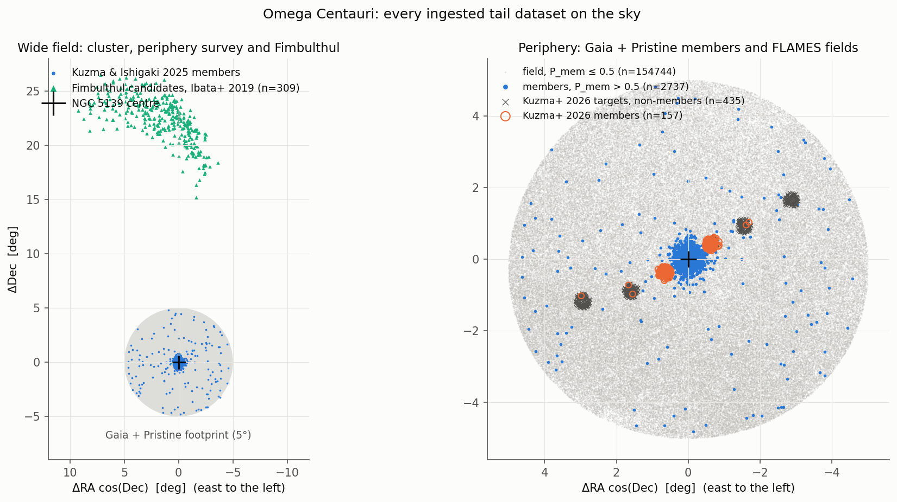
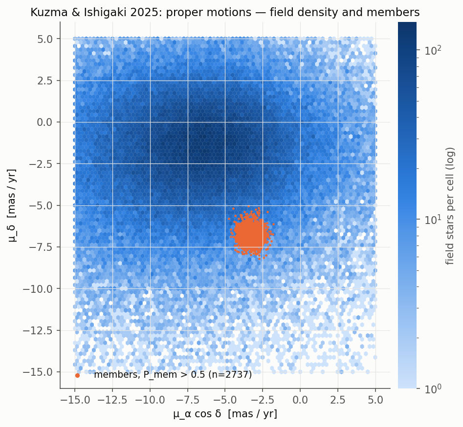
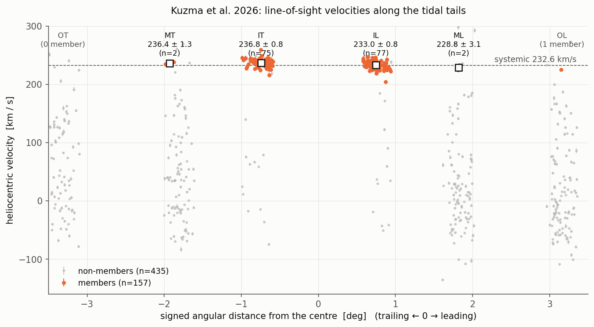
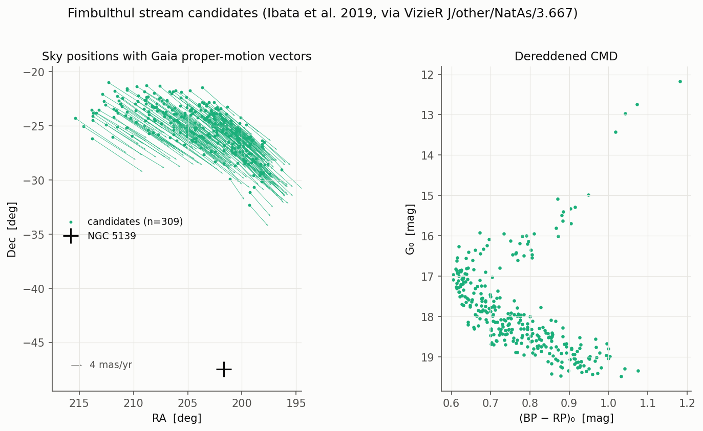

# Periphery, tails and streams

Shorthands are defined on the [Data products](index.md) page.

## Figures

*Every ingested periphery and tail dataset on the sky. Left: the Kuzma & Ishigaki 2025 Gaia+Pristine footprint (5°) and the Fimbulthul candidates of Ibata+2019, 15–27° to the north. Right: the periphery field and members (P > 0.5) with the Kuzma+2026 FLAMES fields (members and non-members).*

*Kuzma & Ishigaki 2025: proper-motion density of the field and the 2,737 members with P > 0.5.*

*Kuzma+2026 FLAMES line-of-sight velocities along the tails (signed distance from the centre, trailing negative): 157 members in six fields, with field means against the systemic velocity. The plot was made with 232.6 km/s; the code now uses 232.7 km/s (`OCEN_VSYS_KMS` in `src/ocen_dm/cluster.py`).*

*Fimbulthul candidates of Ibata+2019 (309 stars): sky positions with proper-motion vectors relative to NGC 5139, and the dereddened CMD.*

## T1/T2. Kuzma & Ishigaki 2025 Pristine periphery and its Gaia covariance

- **Source.**
  - arXiv: https://arxiv.org/abs/2502.01135
  - Journal: https://academic.oup.com/mnras/article/537/3/2752/8002861
  - Data: https://doi.org/10.5281/zenodo.14791430
- **Raw file.** `raw/kuzma2025_pristine/wCen_table.fits` (26,470,080 B). The published md5 `3dcd58e6…` was verified.
- **T1 builder.** `data/kuzma2025.py:117`.
- **T1 product.** `proc/tails/kuzma2025_periphery.ecsv` (57,434,008 B; 157,481 rows; to 5.1°).
  - Columns: `source_id`, `ra`, `dec`, `pmra`, `pmdec`(`_error`), `g0`/`bp0`/`rp0`/`cahk0_mag`, `membership_prob`, `feh(_lo/_hi)`, `src_*`.
  - Metadata rule: "membership_prob is diagnostic only; do not use it as a likelihood weight alongside the same PM/photometric information".
- **T2 builder.** `selection/gaia_covariance.py:50`: WSDB `sqlutilpy.local_join` on `gaia_dr3.gaia_source`, 2026-09-17T01:00Z, matched fraction 1.0.
- **T2 product.** `proc/tails/kuzma2025_periphery_gaia_covariance.ecsv` (37,850,464 B).
  - Metadata rule: "use the full 2x2 PM covariance… parallax terms for a future 3D treatment".
- **Consumers.**
  - `kinematics/periphery.py:64` (fixed-window PM dispersion; documented as circular because membership uses PMs).
  - `kinematics/pristine_profile.py:41` (mixture without a PM cut).
  - `selection/periphery_density.py:49`.
  - `plotting/constraints.py:1187–1466`.
  - `plotting/data_overview.py`.
- **Status.** d. Not in any fit.

## T3. Kuzma et al. 2026 spectroscopy

- **Source.**
  - arXiv: https://arxiv.org/abs/2605.23474
  - DOI: https://doi.org/10.1093/mnras/stag1147
  - ESO programme 108.22MM.001
- **Raw file.** `raw/kuzma2026_spectroscopy/kuzma2026_members.txt` (66,462 B). The user supplied it on 2026-09-16 as the extended Table 3 (592 rows, 157 members). There is no publisher checksum.
- **Reader.** `configs/data.yaml` uses `ascii.commented_header`, `header_start=-1`.
- **Builder.** `data/kuzma2026.py:118`.
- **Product.** `proc/tails/kuzma2026_spectroscopy.ecsv` (66,938 B). Columns `star_id`, `source_id`, `ra`, `dec`, `vlos(_error)` [km/s], `feh(_error)`, `g_mag`, `membership_prob`, `member_flag`.
- **Metadata rule.** "targeted sample: condition on target positions; do not treat detection counts as an unbiased tail surface density". This is also stated in `docs/MANUAL_DOWNLOADS.md`.
- **Consumers.** `kinematics/periphery.py:89`, `plotting/constraints.py:1277`, `plotting/data_overview.py:183,349`.
- **Status.** d. The N-body comparison hard-codes literature numbers instead (`bin/nbody/plot_observed_comparison.py:172–178`).

## T4. Fimbulthul candidates (Ibata et al. 2019)

- **Source.**
  - DOI: https://doi.org/10.1038/s41550-019-0751-x
  - arXiv:1902.09544, per `streams/frames.py:7`
  - VizieR `J/other/NatAs/3.667/tables1`; this is a CDS-curated representation of the published table.
- **Raw file.** `raw/fimbulthul_ibata2019/fimbulthul_supp_table1.vot` (71,578 B; sha256 `9d06aca4…`). The bytes are not reproducible because the VizieR export embeds a timestamp.
- **Builder.** `data/fimbulthul.py:92`.
- **Product.** `proc/tails/fimbulthul_members.ecsv` (37,618 B; 309 rows). Columns `name`, `ra`, `dec`, `pmra/pmdec(_error)`, `parallax(_error)`, `g0_mag`, `bp_rp0`.
- **Metadata rule.** "stream-track constraint only; no absolute density likelihood without a STREAMFINDER selection model".
- **Consumers.** `plotting/data_overview.py:224` only.
- **Status.** d. Superseded for stream modelling by S1 (all 309 are in Ibata+2021 stream 16; 264 are in Ibata+2024 stream 54, per `configs/data.yaml` and the project journal).

## S1–S7. Stream-54 inputs

Moved with the stream work on 2026-10-25: [stream data in oCen_stream](https://vasilybelokurov.github.io/ocen_stream/kb/data/tails_streams/).

## S8. Full Baumgardt GC compilation

- **File.** `CAT/gc_catalog_full.fits` (60,480 B), described as a "Baumgardt & Vasiliev 2021 compilation" in the `sgr_orbit.py:5` docstring.
- **Consumers.** `bin/streams/sgr_orbit.py:29`, `sgr_recent_passages.py:21` (Sgr-passage side study).
- **Not registered.** Only `gc_catalog_updated.fits` is in `datasets.yaml`.
- **Status.** c.

## S9. ω Cen HST Large Programme e-material

- **Location.** `CAT/omegacen_hst_lp/` (P04–P07). `README_provenance.txt` holds the sha256 values; the files were fetched on 2026-10-08 from https://web.oapd.inaf.it/bedin/files/PAPERs_eMATERIALs/wCen_HST_LargeProgram/.
- **Papers:**
  - Scalco+2021, arXiv:2107.08726
  - Gerasimov+2022, arXiv:2111.10063
  - Scalco+2024, A&A 688, A180, [arXiv:2405.19939](https://arxiv.org/abs/2405.19939)
  - Scalco+2024, A&A 691, A96, arXiv:2409.04533
- **Registered** in `configs/data.yaml:63–70` only.
- **Consumers.**
  - Since 2026-10-16 the external fields F1–F5 set the Gaia count completeness: `bin/check_gaia_completeness_lp.py:39` (completeness against radius, `results/plot_data/gaia_completeness_lp.json`) and `bin/build_count_completeness.py`, which imports its functions and writes cG into `proc/kinematics/ocen_counts_gaia_g17_c.json` (product metadata: "sources: HST Large Programme fields F1-F5"; see [cluster data](cluster.md#gaia-completeness-from-the-hst-large-programme-fields-2026-10-16)).
  - That product enters the tied DF refit (`results/df/dftie_restart_20261016`, `dftie_halo_20261016`) and the J-counts Jeans fits through `bin/fit_count_tracer_mge.py`.
  - `bin/plot_hst_lp_cmds.py:41`, writing `results/plot_data/cmd_hst_lp_fields.json` (diagnostic).
- **Status.** a* (through C2 in the tied variant and J-counts), d. Still registered in `configs/data.yaml` only.
