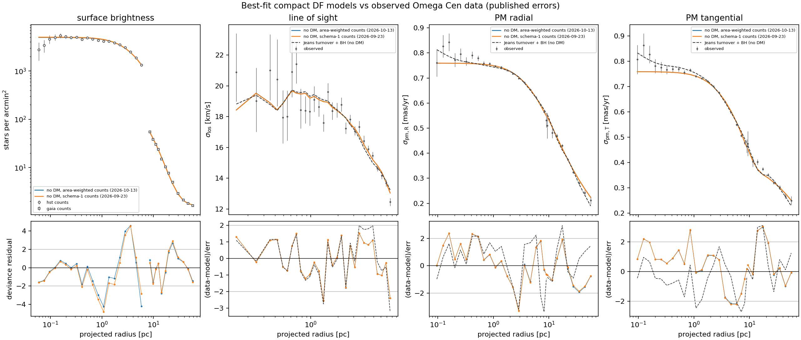
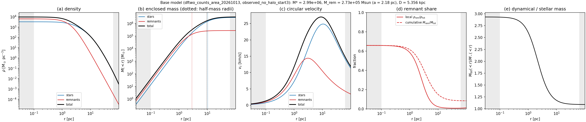
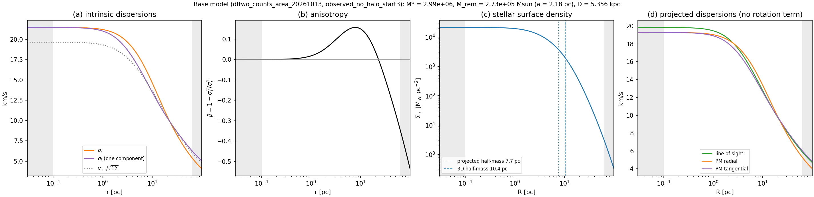
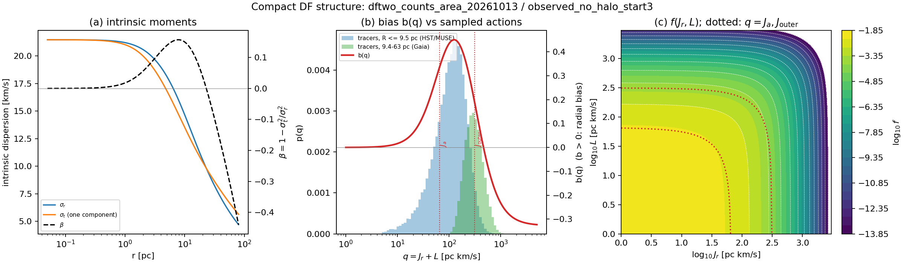

# Base model: two-transition DF, no dark matter

The reference model for the cluster mass distribution. Every dark-matter
variant is compared with it.
The same model with a fixed central black hole is on [DF + central black hole](df_bh.md).

!!! info "Status (2026-10-13)"
    Refitted on 2026-10-13 with the corrected (area-weighted) count
    likelihood: `results/df/dftwo_counts_area_20261013`, best job
    `observed_no_halo_start3`. The fit is numerically validated but **fails
    its own data-fit gate**. It supersedes the 2026-09-23 fit
    (`results/df/dftwo_counts_20260923`), whose star-weighted count averages
    were biased; parameters moved by ≤ 4% and the mass per counted star by
    −1.8%.

## All parameters

The fit is a multi-start optimisation (no posterior sampling), so best-fit
values are given without uncertainties; mocks drawn from this model recover
\(M_\star\) to ±6% and \(M_{\rm rem}\) to ±23% (see below).

**Free parameters (10)**

| # | Parameter | Meaning | Range (prior) | 2026-10-13 (current) | 2026-09-23 |
|---|---|---|---|---|---|
| 1 | \(M_\star\) | stellar mass (DF normalisation) | 10⁶–6×10⁶ M☉, log-uniform | 2.997×10⁶ M☉ | 3.000×10⁶ M☉ |
| 2 | \(J_0\) | DF envelope scale | 30–800 pc km/s, log | 56.0 | 54.1 |
| 3 | \(\alpha\) | DF envelope sharpness | 0.6–3 | 0.805 | 0.798 |
| 4 | \(b_{\rm out}\) | intermediate anisotropy level (>0 radial) | −2 to 2 | +0.767 | +0.739 |
| 5 | \(J_a\) | first anisotropy transition | 5–500 pc km/s, log | 65.5 | 64.5 |
| 6 | \(b_{\rm outer}\) | outer anisotropy level (<0 tangential) | −4 to 2 | −0.327 | −0.330 |
| 7 | \(J_{\rm outer}\) | second transition | 2–100 × \(J_a\) (log ratio) | 312 | 318 |
| 8 | \(M_{\rm rem}\) | remnant (Plummer) mass | 10²–10⁶ M☉, log | 2.73×10⁵ M☉ | 2.62×10⁵ M☉ |
| 9 | \(a_{\rm rem}\) | remnant Plummer scale | 0.3–20 pc, log | 2.18 pc | 2.15 pc |
| 10 | \(D\) | distance | 4.8–6.0 kpc, prior N(5.43, 0.05) | 5.356 kpc | 5.356 kpc |

**Nuisance parameters, profiled analytically at every evaluation (3)**

| Parameter | Meaning | 2026-10-13 |
|---|---|---|
| \(a_{\rm HST}\) | counted F625W < 19 stars per unit model surface density | 6.44×10⁻⁵ |
| \(a_{\rm Gaia}\) | counted G < 17 stars per unit model surface density | 4.69×10⁻⁶ |
| \(b_{\rm Gaia}\) | uniform field density in the Gaia counts | 1.60 arcmin⁻² |

The HST field term is fixed at zero (field < 0.5% at 250″).

**Fixed choices**

| Quantity | Value |
|---|---|
| Dark matter | none (\(\rho_{20}=0\)) |
| Central black hole | none |
| Anisotropy at the centre | \(b(q\to0)=0\) (isotropic core, by construction) |
| Geometry | spherical, non-rotating; published rotation subtracted from the second moments |
| Numerics | potential grid 10⁻⁴–10⁴ pc (128 nodes), 50 equilibrium iterations max, tolerance 5×10⁻⁵ |

**Derived quantities (current fit)**

| Quantity | Value |
|---|---|
| Total mass | 3.26×10⁶ M☉ |
| Mass per F625W < 19 star | 10.48 M☉ |
| \(M_\star/L_V\), \(M_{\rm tot}/L_V\) | 2.6, 2.8 |
| Half-mass radius: stars (3D, projected), remnants | 10.4 pc, 7.7 pc; 2.8 pc |
| Peak circular velocity | 27.0 km/s at 9.0 pc |
| Central velocity dispersion | 21.4 km/s |

## Mass components

| Component | Form | Free parameters (range) | Best fit |
|---|---|---|---|
| Stars | Self-consistent spherical action DF (below); both the counted tracer and the mass that follows the light | \(M_\star\) (1–6×10⁶ M☉, log) | 3.00×10⁶ M☉ |
| Remnants | Plummer potential; gravity only, no DF, not a tracer | \(M_{\rm rem}\) (10²–10⁶ M☉, log), \(a_{\rm rem}\) (0.3–20 pc, log) | 2.73×10⁵ M☉, 2.18 pc |
| Dark matter | none (\(\rho_{20}=0\)) | — | — |
| Central black hole | none | — | — |

### Stellar DF

The regularized exponential action DF (contour construction of Binney 2026,
MNRAS 549, stag854), rebuilt at every iteration and iterated to
self-consistency in the total potential (stars + remnants):

\[
f(\mathbf J)=A\,\exp\!\left[-\left(L_c/J_0\right)^{\alpha}\right],
\qquad q=J_r+L .
\]

The contour label \(L_c\) follows the spherical frequency ratio, biased by the
anisotropy function \(b(q)\): \(b>0\) favours radial orbits, \(b<0\)
tangential ones. Two transitions:

\[
b(q)=b_{\rm out}\,s(q;J_a)+\left(b_{\rm outer}-b_{\rm out}\right)s(q;J_{\rm outer}),
\qquad s(q;J)=\frac{q^2}{q^2+J^2}.
\]

The core is isotropic (\(b\to0\) as \(q\to0\)); the model is radially
anisotropic at intermediate radii and tangential outside.

| Parameter | Meaning | Range | Best fit |
|---|---|---|---|
| \(J_0\) | envelope scale (pc km/s) | 30–800, log | 56.0 |
| \(\alpha\) | envelope sharpness | 0.6–3 | 0.80 |
| \(b_{\rm out}\) | intermediate anisotropy | −2 to 2 | +0.77 (radial) |
| \(J_a\) | first transition (pc km/s) | 5–500, log | 65.5 |
| \(b_{\rm outer}\) | outer anisotropy | −4 to 2 | −0.33 (tangential) |
| \(J_{\rm outer}\) | second transition (pc km/s) | 2–100 × \(J_a\) | 312 |

### How the stellar mass is determined

- **Seven stellar parameters:** the mass normalisation \(M_\star\) and the six
  DF parameters (\(J_0\), \(\alpha\), \(b_{\rm out}\), \(J_a\), \(b_{\rm outer}\),
  \(J_{\rm outer}\)). The stellar density is not an input: it is computed from
  \(f(\mathbf J)\) in the total potential, so the envelope and the anisotropy
  parameters together set its shape.
- **The star counts constrain the shape only.** Their amplitude (counted
  stars per unit model surface density) is a nuisance parameter, profiled
  analytically at every evaluation; the counts say where the stars are, not how
  much mass they carry.
- **\(M_\star\) is set by the kinematics,** jointly with the remnants. It is
  not taken from photometry. The mass per counted star (10.48 M☉ per
  F625W < 19 star) is therefore an output of the fit.
- **The only place \(M_\star\) is fixed externally** is the mass-per-star scan,
  where the count amplitude is held at a value from the photometric mass
  function instead of being profiled.
- **Mass-to-light ratio.** With L_V = 1.16×10⁶ L☉ (Harris catalogue
  V = 3.68 and E(B−V) = 0.12, at the fitted 5.356 kpc), \(M_\star/L_V = 2.6\)
  and \(M_{\rm tot}/L_V = 2.8\).

### Remnant component

\[
\rho_{\rm rem}(r)=\frac{3M_{\rm rem}}{4\pi a_{\rm rem}^3}
\left(1+\frac{r^2}{a_{\rm rem}^2}\right)^{-5/2}
\]

It stands for all mass that does not follow the counted light: neutron stars
and stellar-mass black holes, any mass-segregated white dwarfs and heavy
stars, and part of the effect of a central black hole. At the best fit it
holds 8% of the total mass, has a half-mass radius of \(1.305\,a_{\rm rem}=2.8\)
pc, and dominates the mass inside ~1.5 pc (60% inside 1 pc).

**Comparison with the literature:** published fits find 1.35–2.65×10⁵ M☉ in a central non-luminous component; Bañares-Hernández+2025 fit the same Plummer form and get 2.65×10⁵ M☉ with a 1.88 pc scale. Details: [Remnant mass and spatial scale](../literature_comparison.md#remnant-mass-and-spatial-scale).

**Is this remnant mass physically sensible?** It is 8.4% of the total and 0.09 of the stellar mass, inside the IMF budget for remnants heavier than the tracer stars (8.7–11.8% with all black holes retained): [Remnant mass and the stellar population](../remnant_mass.md).

### Distance, geometry, rotation

- Distance free in 4.8–6.0 kpc with a Gaussian prior \(N(5.43, 0.05)\) kpc;
  best fit 5.356 kpc (1.5σ low).
- Spherical and non-rotating. The published rotation is removed at the
  moment level, \(\sigma^2_{\rm pred}=\langle v^2\rangle_{\rm DF}-v^2_{\rm rot}\);
  a negative result is rejected, never floored.

## Data and likelihood

Objective \(=-2\ln L\) (up to a constant):

| Term | Data | Likelihood |
|---|---|---|
| Kinematics, 89 bins | HST PM radial and tangential (21 + 21), MUSE LOS (29), Gaia EDR3 PM radial and tangential (9 + 9) | split-normal with the published errors |
| HST counts | oMEGACat, F625W < 19, 20 bins over 2–250″, 117 751 stars | Poisson, amplitude profiled |
| Gaia counts | Vasiliev & Baumgardt 2021, G < 17, 12 bins over 300–2400″ | Poisson, amplitude and uniform field profiled |
| Distance prior | — | Gaussian |

The count amplitude converts to a mass per counted star: the best fit has
10.48 M☉ of light-following mass per F625W < 19 star (10.67 in the
2026-09-23 fit). Details of every
product: [Data products](../data/index.md).

## Fit quality

| Term | 2026-10-13 | 2026-09-23 | Gate | Pass |
|---|---|---|---|---|
| \(\chi^2_{\rm kin}\) per bin | 156.4 / 89 = 1.76 | 158.1 / 89 = 1.78 | ≤ 1.3 | no |
| HST PM radial | 2.03 per bin | 2.06 | ≤ 2.0 | no |
| HST PM tangential | 1.89 per bin | 1.95 | ≤ 2.0 | yes |
| MUSE LOS | 1.31 per bin | 1.31 | ≤ 2.0 | yes |
| Gaia PM radial | 1.60 per bin | 1.55 | ≤ 2.0 | yes |
| Gaia PM tangential | 2.39 per bin | 2.43 | ≤ 2.0 | no |
| HST count deviance | 96.9 / 20 = 4.8 per bin | 98.9 | ≤ 2.0 | no |
| Gaia count deviance | 25.2 / 12 = 2.1 per bin | 26.3 | ≤ 2.0 | no |
| Total objective | 280.7 (incl. distance prior 2.2) | 285.6 | — | — |

The two fits use different count likelihoods, so their objectives are not
directly comparable; the table shows that the correction changes little.
The HST count residuals remain structured: the data lie below the model
near 1 pc and in the outermost HST bin (~6 pc), with deviance residuals of
about −4, and above it at 3–4 pc (+4.6).



*Counts (HST and Gaia), MUSE line-of-sight and HST/Gaia proper-motion
dispersions against the 2026-10-13 (blue) and 2026-09-23 (orange) fits,
with the earlier Jeans model (dashed). Bottom row: residuals; the count
panel shows signed Poisson deviance residuals. Both fits are evaluated with
the corrected count likelihood.*

## Comparison with the Jeans model (dashed curves)

Full description, figures and posterior: [Jeans comparison model](jeans_comparison.md).

The dashed curves are the best rung-2 spherical Jeans fit without dark matter
(`results/fits/rung2_K1_turnover`), the best model of the earlier
[Jeans ladder](index.md#earlier-spherical-jeans-ladder-historical).
Both models are fitted to the same 89-bin kinematic snapshot, so their
kinematic χ² compare directly; the Jeans fit uses a fixed light profile (an MGE
of the Trager+1995 profile joined to HST star counts) instead of the Poisson
star counts.

| | Jeans (rung 2, no DM) | DF base model |
|---|---|---|
| Stellar tracer and mass | MGE light profile, mass-to-light free | self-consistent action DF |
| Free stellar parameters | \(M_\star\) only (density shape fixed by the light) | \(M_\star\) and six DF parameters (shape fitted to the counts) |
| Anisotropy | turnover β(r): β₀ = −0.50 (centre) → +0.20 → −0.98 (outside) | isotropic core → +0.15 near 8 pc → −0.53 at 100 pc |
| Central black hole | 4.4×10⁴ M☉ (16–84%: 3.9–4.6×10⁴) | none |
| \(M_\star\) | 2.37×10⁶ M☉ | 3.00×10⁶ M☉ |
| Remnants (Plummer) | 7.7×10⁵ M☉, a = 5.7 pc | 2.7×10⁵ M☉, a = 2.2 pc |
| Total mass | 3.18×10⁶ M☉ | 3.26×10⁶ M☉ |
| \(M_\star/L_V\), \(M_{\rm tot}/L_V\) | 2.0, 2.7 (ML); 2.3, 2.8 (median) | 2.6, 2.8 |
| Distance | 5.34 kpc | 5.36 kpc |

| χ² (per bin) | Jeans | DF |
|---|---|---|
| HST PM radial (21) | 61.8 (2.94) | 42.6 (2.03) |
| HST PM tangential (21) | 36.6 (1.74) | 39.8 (1.89) |
| MUSE LOS (29) | 51.7 (1.78) | 38.1 (1.31) |
| Gaia PM radial (9) | 16.9 (1.88) | 14.4 (1.60) |
| Gaia PM tangential (9) | 23.0 (2.56) | 21.5 (2.39) |
| **Total (89)** | **190.0** | **156.4** |

- **The DF fits better overall** (Δχ² = 34) and in every dataset except the
  HST tangential proper motions.
- **The Jeans model follows the central rise** of the HST proper-motion
  dispersions inside 0.3 pc (~11″), which the DF, with an isotropic core and
  no black hole, stays below by 1.5–2.4σ in several bins: χ² = 7.3 (Jeans)
  against 21.5 (DF) for those 10 bins. This is where the black hole matters.
- **It pays for this at intermediate radii:** at 2–20 pc (36 bins of HST,
  MUSE and Gaia) χ² = 122.2 (Jeans) against 77.8 (DF), mostly in the HST
  radial proper motions (40.2 against 20.2) and the MUSE line-of-sight
  dispersions (30.9 against 18.7).
- **The black hole is tied to an imposed anisotropy.** A cored stellar density
  around a point mass needs β₀ ≤ −½ for any non-negative DF; the prior enforces
  it and the fit sits at the bound (β₀ = −0.503). Even so, under the standard
  separable construction a non-negative DF fails to exist at 0.02–0.18 pc,
  where the black hole dominates (89.7% of posterior draws fail; no failure
  outside ~0.2 pc; a non-separable DF is not excluded;
  [DF consistency audit](../../DF_CONSISTENCY_AUDIT.md)). The DF base model is
  non-negative by construction.
- **Both put about the same total mass** in the cluster (3.2–3.3×10⁶ M☉) but
  divide it differently: the Jeans fit has 20% less stellar mass and nearly
  three times more remnant mass, spread over a 2.5× larger scale. This is the
  same stars-versus-dark-mass degeneracy seen within the DF fits.
- **Why \(M_\star\) differs by 11% at the same total mass.** In neither model
  is the stellar mass fixed by the light or the counts; it is the
  normalisation the kinematics leave after the remnants (and, for Jeans, the
  black hole and the imposed central anisotropy) take their share. The
  remnant mass is close to the total minus \(M_\star\), so with remnants at
  8–17% of the total, a 1% change in \(M_\star\) moves \(M_{\rm rem}\) by ~10%.
- A central black hole was not supported by the DF fits on binned data
  (September step 3); whether the inner rise needs one, or radially biased
  central orbits, or mass segregation, is not settled.

## Properties of the fitted model



*By component: (a) density; (b) enclosed mass with half-mass radii dotted;
(c) circular velocity; (d) remnant share, local and cumulative; (e)
dynamical-to-stellar mass ratio. Grey: outside the radial range of the
kinematic data (0.1–63 pc).*



*(a) Intrinsic radial and tangential dispersions; (b) anisotropy β(r);
(c) stellar surface density with half-mass radii; (d) projected
line-of-sight and proper-motion dispersions from the DF (before the
published rotation is subtracted).*



*(a) Intrinsic moments; (b) anisotropy bias b(q) over the action
distributions of the HST/MUSE and Gaia stars; (c) f(J_r, L).*

Key numbers (current fit): stellar half-mass radius 10.4 pc (projected
7.7 pc), remnant half-mass radius 2.8 pc; remnants 66% of the central
density; \(M_{\rm tot}/M_\star\) from 2.9 in the centre to 1.09 overall;
peak circular velocity 27.0 km/s at 9 pc; central dispersion 21.4 km/s;
β peaks at +0.15 near 8 pc and reaches −0.53 at 100 pc. Interpretation:
[Results](../results.md#base-model-fits).

## What has been tested

- **Convergence**: 4 of 6 starts valid (2 Latin starts infeasible), all four
  reach the same minimum (objectives within 0.01); no parameter at a bound.
- **Numerics**: grid refinement shifts predictions by 0.0005σ; direct
  projection checks agree to ≤ 5×10⁻⁴ in Σ, LOS, PM_R and PM_T.
- **Estimator recovery** (2026-09-23 fit, old count likelihood): 12 mocks drawn from this model with published
  kinematic noise and Poisson counts recover the total mass to ±3% at 20 pc
  and ±5% over 2–40 pc, \(M_\star\) to ±6%, \(M_{\rm rem}\) to ±23%.

Not yet tested: mocks whose truth
breaks the model's own assumptions (mass segregation, rotation, another
remnant shape); calibration of the error bars.

## Built-in assumptions

1. Mass follows light: one stellar DF is both tracer and mass.
2. Isotropic core.
3. One remnant component with a fixed Plummer shape.
4. No central black hole.
5. Spherical; rotation subtracted from published curves.
6. Published error bars taken as they are.

## Reproduce

```bash
source <venv>/bin/activate
export PYTHONPATH=src
python bin/run_compact_df_recovery.py prepare-real --out results/df/<new_label> \
  --two-transition --branches no_halo \
  --counts ocen_counts_hst_f625w19,ocen_counts_gaia_g17 \
  --free-distance 4.8:6.0 --distance-prior 5.43:0.05 \
  --bound stellar.J0=30:800 --bound stellar.J_a=5:500 --bound stellar.b_out=-2:2 \
  --hand-starts 2 --n-starts 4 --probe-workers 5
python bin/run_compact_df_recovery.py run --out results/df/<new_label> --workers 2 --max-calls 600
```

Each run uses 2 jobs × (5 probe workers + 1) = 12 cores and took ~30 min in
September. The batch freezes its source, configuration and inputs; a run
directory is never reused.

Code: `src/ocen_dm/kinematics/regularized_df.py` (DF, remnants, halo),
`df_fit.py` (joint problem), `counts.py` (count likelihood),
`compact_recovery.py` (mocks, residuals), `bin/run_compact_df_recovery.py`
(driver).

## Related results

- Dark-matter variants and the \(\rho_{20}\) and mass-per-star scans:
  [DF observed fit write-up](../../df_observed_fit.pdf).
- Review of next steps: [Codex review, 2026-10-13](../../reviews/codex_mass_model_next_2026-10-13.md).
