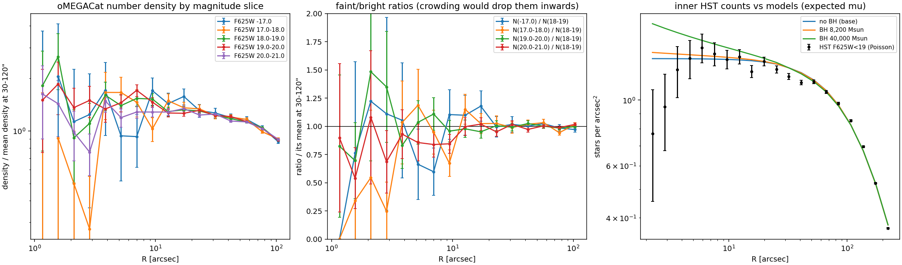
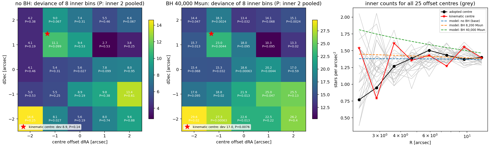

# Central black hole: cusp depletion (proposal)

!!! warning "Status: proposal, not adopted"
    Proposed 2026-10-15. **No decision has been taken**: no code for the depletion term exists
    and no fits with it have been run. The model in use is unchanged. This page records the
    evidence, the proposal, its costs and the open questions so the decision can be taken later.

## In short

- Adding a central point mass (black hole) to our stellar DF forces an isotropic stellar
  cusp, ρ ∝ r−3/2, around it. This follows from a DF that stays finite at small actions.
- With MBH = 4×104 M⊙ the model reproduces the central rise of the
  proper-motion and line-of-sight dispersions. But it over-predicts the HST star counts at
  2–13″ (0.05–0.35 pc), where the counts are flat.
- That excess is not explained by crowding or by the choice of centre (tests below). The
  published completeness-corrected counts are also flat: projected slope 0.00 ± 0.07 inside 15″.
- **Proposal:** a one-parameter depletion of the most bound orbits, which lets the model have a
  shallower cusp around the black hole.

## Evidence

### Fits with a fixed central point mass

The black-hole mass was fixed. Everything else was refitted: stellar mass, remnant mass and
scale, distance, DF shape. Each fit used one start, seeded from the no-BH best fit, and was
restarted from its own best point, changing the objective by less than 0.004. Otherwise the
settings were those of the [base model](base_no_dm.md).

| Model | Objective | χ²kin (89 bins) | HST counts deviance (20 bins) | Gaia counts deviance (12 bins) | M★ | Mrem | arem (pc) | Total mass |
|---|---|---|---|---|---|---|---|---|
| No BH (base) | 280.7 | 156.4 | 96.9 | 25.2 | 3.00×10⁶ | 2.73×10⁵ | 2.18 | 3.27×10⁶ |
| BH 8,200 M⊙ | 275.2 | 152.7 | 95.9 | 24.5 | 2.96×10⁶ | 2.89×10⁵ | 2.43 | 3.26×10⁶ |
| BH 4×10⁴ M⊙ | 279.7 | 144.5 | 112.0 | 21.6 | 2.67×10⁶ | 5.04×10⁵ | 4.05 | 3.21×10⁶ |

- **Columns.** The objective is χ²kin plus the two Poisson count deviances; lower is
  better. Masses are in M⊙. The total mass is M★ + Mrem + MBH;
  there is no dark-matter halo in these fits.
- **Not a measurement.** None of the three passes the data-fit gate (χ² per bin ≈ 1.7), so the
  differences are not yet calibrated. That needs mocks with an injected black hole.
- **How the 4×10⁴ fit compensates.** Less stellar mass, more remnant mass spread over a larger
  scale (its central density is 0.29 of the base value), and a more radial inner DF.

### The central HST counts

The HST counts are all oMEGACat stars with F625W < 19.

| Check | Result |
|---|---|
| Crowding: oMEGACat magnitude-slice ratios (< 17, 17–18, 19–20 against 18–19) | flat inside 10″ to 10–20 %; only F625W 20–21 may be 10–15 % low. This test cannot see losses common to all magnitudes |
| Poisson: inner two bins (2–3.2″) | observed 6, 12. No BH: expected 10.8, 17.5 (P = 0.09, 0.11). BH 4×10⁴: expected 14.1, 22.1 (P = 0.013, 0.014) |
| Centre: 25 centres within ±2″ plus the oMEGACat VI kinematic centre | the innermost "drop" is noise from the centre choice (innermost bin holds 3–16 stars). Over the 8 inner bins (2–13″), BH 4×10⁴ is worse than no BH at **every** centre: deviance +6 to +19, median +12. BH 8,200 cannot be told apart from no BH (−0.6 to +1.8) |
| Literature | Anderson & van der Marel 2010: completeness-corrected counts (> 80 % complete even at the centre) are flat, with a marginally lower centre. van der Marel & Anderson 2010: projected slope inside 15″ is 0.00 ± 0.07. oMEGACat publishes no artificial-star tests |

Scripts: `bin/check_hst_count_completeness.py`, `bin/check_count_centre.py`.

### Expectations from simulations

- **N-body-style models.** González Prieto et al. 2025 grew black holes of 47,000–51,000 M⊙
  in omega Cen models. The stars settle to a 3-D density slope γ ≈ 1.3, and the models predict a
  slightly brighter inner core than observed.
- **Projected slopes.** Baumgardt, Makino & Hut 2005 find shallow projected slopes of bright stars,
  about −0.1 to −0.3, even with a black hole.
- **Our cusp is steeper than both.** Our DF is forced to γ = 1.5 inside the black hole's sphere of
  influence: 0.07 pc for 8,200 M⊙, about 0.3 pc for 4×10⁴ M⊙.

## The proposal

Multiply the stellar DF by a depletion factor in the contour label Lc:

$$
D(L_c)=\frac{(L_c/J_c)^p}{1+(L_c/J_c)^p},
$$

renormalised, in both the DF and its normalisation integral, so that the stellar mass is unchanged.

- **One new free parameter, Jc,** the depletion scale. With Jc = 0 the model is exactly the current one.
- **p is fixed per experiment.** In an isotropic Kepler region the density goes as
  r−(3−p)/2 for p < 2, as r−1/2 log r for p = 2, and as r−1/2 for p > 2.
  The plan is p = 4 first (the shallowest cusp, r−1/2), then p = 1 and p = 0.4
  (limiting slopes 1 and 1.3). p would be freed only if mocks show the data can separate it from Jc.
- **Why depletion in Lc, not in the total action.** It keeps the existing
  energy-like contours and so does not change the DF's angular weighting (Codex review).
- **Physical motivation, if adopted.** The central cusp has been depleted, for example by
  scouring or a cusp that has not regrown. The depletion term is a phenomenological stand-in,
  not a model of that process.

## Consequences and caveats

- **Kinematics.** In a black-hole-dominated power-law region σr² = GM/((γ+1) r).
  Depleting the cusp (γ from 1.5 to 0.5) raises the local dispersion by 5/3, while projection
  weakens the observed rise. Black-hole mass and depletion may trade off, in no fixed direction,
  so any result needs a profile in (MBH, Jc).
- **Scope of the depletion.** It applies to the whole self-gravitating stellar DF, not only to
  the counted tracer. The count likelihood cannot represent a radial change of mass per counted star.
- **Remnants stay a fixed Plummer sphere** (declared caveat). Stellar depletion and a remnant
  cusp should not both be freed in the first experiment. A concentrated-remnant alternative is a
  separate later test.
- **Numerical risks.** Two need independent checks:
    - the near-escape velocity shell, which may dominate a strongly depleted centre;
    - the action guard, whose "can only remove mass" argument fails for a non-monotonic DF.

## Validation needed before any fit

1. Jc = 0 reproduces the current model exactly; configuration and optimizer round trips; positivity.
2. Kepler density **and pressure** benchmarks for p < 2, p = 2 and p > 2.
3. An independent escape-shell reference, and convergence of every count expectation and dispersion bin.
4. The guard against exact actions across the depleted family; independent mass normalisation.
5. Multiple starts at MBH = 0, 8,200 and 4×10⁴, and profiles in (MBH, Jc).
6. Mocks with injected depleted and undepleted truths before any significance is quoted.

## Cost

- **Code and validation (items 1–4):** about half a day.
- **Fits:** about 1–2 hours per black-hole mass on 6 cores. The first set (three masses, p = 4)
  takes about 4–6 hours; each further p value repeats that.
- **Mocks:** extra, to be sized when needed.

## Alternatives that need no new parameter

- **Keep the model and report the tension.** This is a defensible result in its own right.
- **Fit only R > 3″ counts,** as a sensitivity case only. It cannot remove a tension that
  extends to 13″.
- **Other forms,** each with a different physical meaning: depletion in energy (equivalent to
  Lc in pure Kepler), a DF floor, a loss cone (suppresses low angular momentum and
  predicts tangential anisotropy), or a centrally concentrated remnant component.

## Decisions pending

1. Adopt the depletion term at all (or one of the alternatives)?
2. If yes: run the validation, then the fits, and in which order?

## Sources

- Codex reviews (2026-10-15):
    - [point mass in the DF](../../reviews/codex_df_point_mass_2026-10-15.md);
    - [AGAMA actions with a point mass](../../reviews/codex_agama_point_mass_2026-10-15.md);
    - [central counts, research pass](../../reviews/codex_central_counts_research_2026-10-15.md);
    - [depletion design](../../reviews/codex_cusp_depletion_2026-10-15.md).
- Papers:
    - Anderson & van der Marel 2010, [arXiv:0905.0627](https://arxiv.org/abs/0905.0627);
    - van der Marel & Anderson 2010, [arXiv:0905.0638](https://arxiv.org/abs/0905.0638);
    - González Prieto, Rodriguez & Cabrera 2025, [arXiv:2507.06316](https://arxiv.org/abs/2507.06316);
    - Baumgardt, Makino & Hut 2005, [arXiv:astro-ph/0410597](https://arxiv.org/abs/astro-ph/0410597);
    - Häberle et al. 2024 (oMEGACat II), [arXiv:2404.03722](https://arxiv.org/abs/2404.03722).
