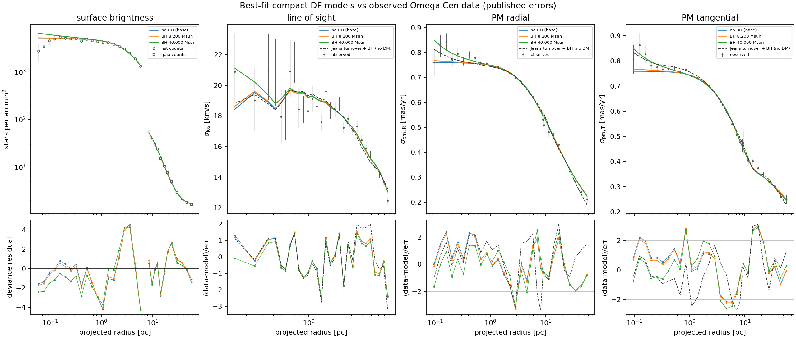
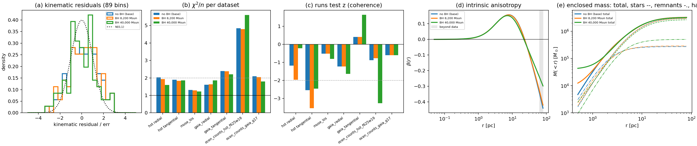
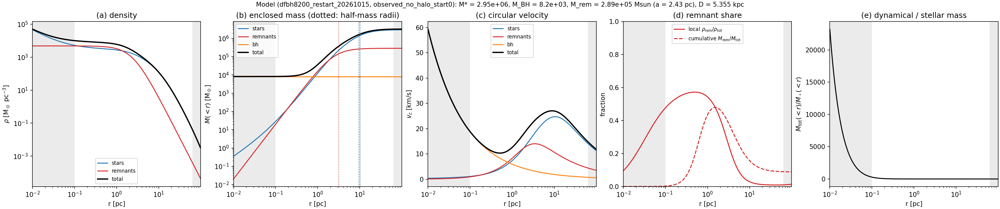
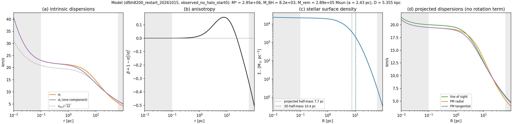
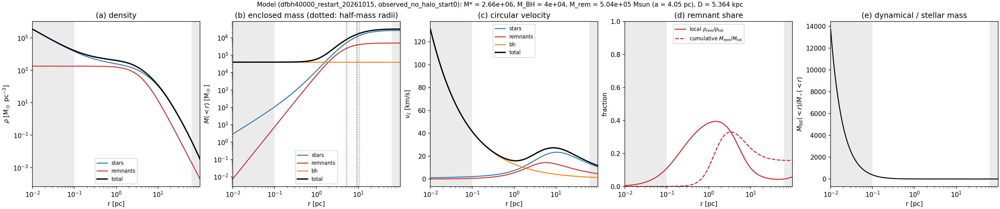
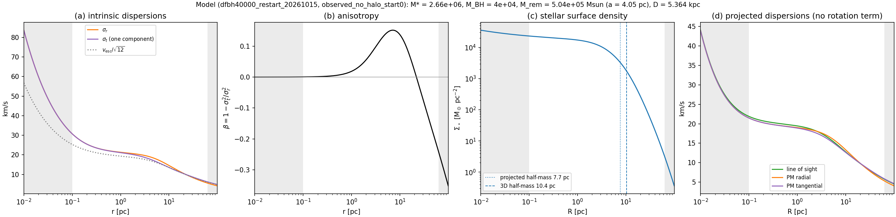

# DF + central black hole

The [base model](base_no_dm.md) with an exact central point mass added to the potential.
The black-hole mass is **fixed** in each fit, at 8,200 M⊙ or 4×104
M⊙. Every other parameter is refitted. Fitted 2026-10-15.

- **Why these two masses.** 8,200 M⊙ is the robust lower limit from the fast stars
  (Häberle et al. 2024). 4×104 M⊙ is close to the masses preferred by
  that paper's acceleration and N-body analyses, and to our Jeans comparison model (4.3×104).
- **Not a measurement.** The black-hole mass is not free, none of the three models passes the
  data-fit gate, and the objective differences are not yet calibrated with mocks.
- **Next step, undecided.** The [cusp-depletion proposal](bh_cusp_depletion.md) records the
  tension with the central star counts found here and a possible model extension.

## What the black hole changes

- **Potential.** A Plummer sphere of zero scale radius, i.e. an exact point mass, is added to
  the stars and the fixed Plummer remnants. The stellar DF is solved self-consistently in the
  total potential, as in the base model.
- **Central stellar cusp.** The DF stays finite at small actions, so around a point mass it
  produces an isotropic cusp ρ★ ∝ r−3/2. This sets in inside the sphere of
  influence: 0.07 pc for 8,200 M⊙ and about 0.3 pc for 4×104 M⊙.
  This is a property of the DF family, not a fitted result.
- **Numerics.** Orbit frequencies and actions around the point mass use AGAMA, with exact
  quadratures substituted where AGAMA's spherical routines fail near a point mass. Those
  failures are NaN, unbound or wrongly sized orbits, mostly far outside the cluster. AGAMA's
  ordinary errors move the bin predictions by at most 0.01σ. Models without a black hole are
  unchanged (the base fit is reproduced exactly).

## All parameters

Free parameters are fitted; nuisance parameters are profiled analytically; MBH is
fixed per fit. Ranges are as in the [base model](base_no_dm.md#all-parameters).

| # | Parameter | Meaning | No BH (base) | MBH = 8,200 M⊙ | MBH = 4×10⁴ M⊙ |
|---|---|---|---|---|---|
| — | MBH | central point mass (**fixed**) | 0 | 8,200 M⊙ | 4.0×10⁴ M⊙ |
| 1 | M★ | stellar mass (DF normalisation) | 2.997×10⁶ M⊙ | 2.962×10⁶ M⊙ | 2.667×10⁶ M⊙ |
| 2 | J0 | DF envelope scale (pc km/s) | 56.0 | 56.2 | 57.4 |
| 3 | α | DF envelope sharpness | 0.805 | 0.806 | 0.811 |
| 4 | bout | intermediate anisotropy level (> 0 radial) | +0.767 | +0.793 | +1.624 |
| 5 | Ja | first anisotropy transition (pc km/s) | 65.5 | 66.5 | 97.8 |
| 6 | bouter | outer anisotropy level (< 0 tangential) | −0.327 | −0.312 | −0.224 |
| 7 | Jouter | second transition (pc km/s) | 312 | 300 | 196 |
| 8 | Mrem | remnant (Plummer) mass | 2.73×10⁵ M⊙ | 2.89×10⁵ M⊙ | 5.04×10⁵ M⊙ |
| 9 | arem | remnant Plummer scale | 2.18 pc | 2.43 pc | 4.05 pc |
| 10 | D | distance, prior N(5.43, 0.05) kpc | 5.356 kpc | 5.355 kpc | 5.364 kpc |

**Nuisance parameters (profiled):**

| Parameter | Meaning | No BH | 8,200 | 4×10⁴ |
|---|---|---|---|---|
| aHST | counted F625W < 19 stars per unit model surface density | 6.44×10⁻⁵ | 6.51×10⁻⁵ | 7.25×10⁻⁵ |
| aGaia | counted G < 17 stars per unit model surface density | 4.69×10⁻⁶ | 4.75×10⁻⁶ | 5.37×10⁻⁶ |
| bGaia | uniform field density in the Gaia counts | 1.60 arcmin⁻² | 1.60 arcmin⁻² | 1.58 arcmin⁻² |

**Derived quantities:**

| Quantity | No BH | 8,200 | 4×10⁴ |
|---|---|---|---|
| Total mass (M★ + Mrem + MBH) | 3.27×10⁶ M⊙ | 3.26×10⁶ M⊙ | 3.21×10⁶ M⊙ |
| Mass per F625W < 19 star | 10.48 M⊙ | 10.35 M⊙ | 9.33 M⊙ |
| M★/LV, Mtot/LV | 2.6, 2.8 | 2.6, 2.8 | 2.3, 2.8 |
| Half-mass radius: stars 3-D, stars projected, remnants | 10.4, 7.7, 2.8 pc | 10.4, 7.7, 3.2 pc | 10.4, 7.7, 5.3 pc |
| Circular velocity at 0.3, 1, 10 pc | 3.9, 11.8, 27.0 km/s | 11.5, 12.6, 27.0 km/s | 24.3, 16.0, 27.2 km/s |
| Intrinsic σr at 0.3 pc | 21.4 km/s | 21.8 km/s | 23.7 km/s |

- **M/L.** LV = 1.16×10⁶ L⊙, as in the base model, scaled to each fitted distance.
- **Circular velocity.** With a black hole it rises again inwards (Keplerian) inside about
  1 pc. The outer maximum, about 27 km/s near 10 pc, is the same in all three models.
- **Remnants in the 4×10⁴ fit.** Their mass is larger but much more extended: their central
  density is 0.29 of the base value.

## Fit quality

| Term | Gate | No BH | 8,200 | 4×10⁴ |
|---|---|---|---|---|
| χ²kin per bin (89 bins) | ≤ 1.3 | 156.4 / 89 = 1.76 | 152.7 / 89 = 1.72 | 144.5 / 89 = 1.62 |
| HST PM radial, per bin | ≤ 2.0 | 2.03 | 1.93 | 1.60 |
| HST PM tangential, per bin | ≤ 2.0 | 1.89 | 1.83 | 1.86 |
| MUSE LOS, per bin | ≤ 2.0 | 1.31 | 1.29 | 1.22 |
| Gaia PM radial, per bin | ≤ 2.0 | 1.60 | 1.64 | 1.85 |
| Gaia PM tangential, per bin | ≤ 2.0 | 2.39 | 2.38 | 2.20 |
| HST count deviance (20 bins) | ≤ 2.0 per bin | 96.9 (4.8) | 95.9 (4.8) | 112.0 (5.6) |
| Gaia count deviance (12 bins) | ≤ 2.0 per bin | 25.2 (2.1) | 24.5 (2.0) | 21.6 (1.8) |
| Distance prior term | — | 2.2 | 2.3 | 1.7 |
| **Total objective** | — | **280.7** | **275.2** | **279.7** |

- **No model passes the data-fit gate.** All three pass the numerical-validation gate, and no
  parameter sits at a bound.
- **8,200 M⊙** improves every term slightly: the objective falls by 5.5.
- **4×104 M⊙** fits the central kinematics better (χ²kin −12),
  mainly the HST radial proper motions. But it loses 15 on the HST counts, so the objective
  falls by only 1.0.
- **Convergence.** Each BH fit is a single start from the no-BH best fit, restarted from its own
  best point; the restarts changed the objective by less than 0.004.

The two count profiles do not join, by design: they are different selections in their own units. HST counts are oMEGACat stars with F625W < 19 at 2–250″; Gaia counts are stars with G < 17 at 300–2400″. The brighter Gaia limit counts about 14 times fewer stars per unit stellar mass, so each profile has its own fitted count amplitude (aHST, aGaia), and the Gaia model also includes a uniform field of about 1.6 stars arcmin⁻². The model curves are the same stellar surface density scaled by each amplitude. The gap between 250″ and 300″ is a gap in coverage. Their ratio has been measured where the two catalogues overlap: see [the count-ratio check](../data/cluster.md#ratio-of-the-two-count-products-in-the-overlap-2026-10-16). Corrected for completeness, the fitted ratio is 7–9 % higher than expected (13.5–13.7 against 12.6 ± 0.3).

What the data comparison shows:

- **Inside about 0.3 pc,** only the 4×104 model rises in proper-motion dispersion, to
  about 0.85 mas/yr, and in LOS dispersion, to about 21 km/s. That matches the innermost HST and
  MUSE points, like the [Jeans comparison model](jeans_comparison.md). The 8,200 model rises only
  in the innermost bin.
- **The same cusp over-predicts the HST star counts at 2–13″** (0.05–0.35 pc), where the counts
  are flat. That excess is not explained by crowding or by the choice of centre; see the
  [checks on the proposal page](bh_cusp_depletion.md#the-central-hst-counts).
- **Beyond about 1 pc,** the three models cannot be told apart.

## Physical properties

### MBH = 8,200 M⊙

### MBH = 4×104 M⊙

- **Panels and shading** are as for the [base model](base_no_dm.md). The black hole appears in
  the enclosed-mass and circular-velocity panels. Shading marks radii outside the kinematic
  data (0.1–63 pc).
- **Inner rise.** Inside about 0.1 pc the intrinsic dispersions and the stellar density rise
  inwards. That is the r−3/2 cusp, which lies mostly inside the innermost data bins.

## Data, likelihood and settings

- **As the base model.** Same 89 kinematic bins, HST and Gaia count profiles, and likelihood
  ([base model: data and likelihood](base_no_dm.md#data-and-likelihood)).
- **Fit settings.** Two-transition DF, no halo, free distance with the N(5.43, 0.05) kpc prior,
  `--fix matter.M_bh`, equilibrium tolerance 5×10⁻⁵.
- **Runs:**
    - fits: `results/df/dfbh{8200,40000}_seed_20261015`;
    - restarts (the values above): `results/df/dfbh{8200,40000}_restart_20261015`;
    - figures: `bin/plot_best_fit_performance.py`, `bin/plot_base_model_properties.py`.

## Caveats

- **Fixed mass, single start.** MBH is fixed, not fitted, and each mass has one
  start, so these are compatibility tests, not a black-hole mass measurement.
- **Imposed cusp.** The central cusp comes from the DF family, not from the data. A depleted
  cusp ([proposal](bh_cusp_depletion.md)) could change the preferred mass in either direction.
- **Fixed Plummer remnants.** The remnants stay a fixed Plummer sphere, with no central
  concentration of heavy remnants.
- **Uncalibrated differences.** Objective differences are not yet calibrated: χ² per bin is
  about 1.7 in all three models, so mocks with an injected black hole are needed before any
  significance is quoted.
