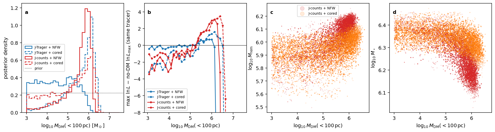
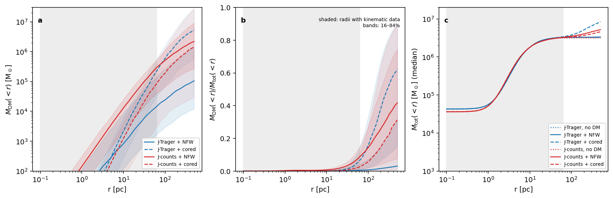
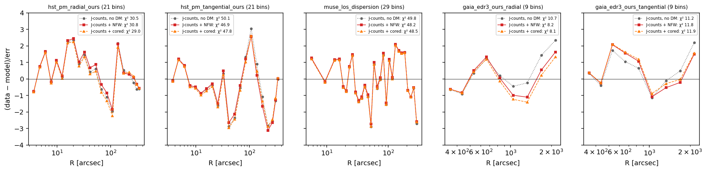

# Dark-matter fits of the reference models

Each reference model is refitted with a dark-matter halo added, with all other ingredients unchanged (fits of 2026-10-16; J-Trager halo runs of 2026-09-21).

- **Jeans models.** These are J-Trager (tracer: composite HST/Trager light profile) and J-counts (tracer: completeness-corrected HST + Gaia star counts with the tied amplitude ratio; [twin model](jeans_comparison.md#twin-model-with-the-star-count-tracer-j-counts-2026-10-16)). Each is fitted with an NFW halo and with a cored halo.
- **DF model.** This is the [tied, completeness-corrected refit](base_no_dm.md#refit-with-completeness-corrected-counts-and-tied-amplitudes-2026-10-16), fitted with a free cored halo.

## Summary

- **Neither tracer needs dark matter.**
    - The evidence changes by Δln Z = +0.1 and +1.2 (J-Trager) and +1.1 ± 0.6 and +0.5 ± 0.8 (J-counts) for NFW and cored halos.
    - The best-fit likelihood improves by at most 3.5 for 2 extra parameters.
- **The DF fit drives the halo to zero.** All three starts end at ρ20 ≈ 0, and none beats the no-halo objective.
- **The halo the Jeans fits allow sits mostly outside the kinematic data.**
    - Inside the outermost kinematic bin (63 pc), the dark-matter share of the mass is below about 10 %.
    - Inside the data the total mass is the same with and without a halo; the models differ only beyond it.
- **The small likelihood gain comes from two bins**, the outermost Gaia PM bins (beyond about 1,500″). These are the bins most exposed to tidal effects and escaping stars.
- **The halo mass is not measured.** MDM(<100 pc) spans more than a factor of 10 and trades against the stars and remnants.
- **The black-hole mass is unchanged** by the halo: 3.6–3.7×10⁴ M⊙ with the count tracer, 4.3×10⁴ M⊙ with Trager.

## Set-up

| | Jeans models | DF model |
|---|---|---|
| Data | the frozen 89-bin kinematic snapshot (shared by all runs) | same, plus the tied count likelihood |
| Halo | ρ ∝ r−γ(1 + r/rs)γ−3, taper 1 kpc; NFW γ = 1 or cored γ = 0 | cored (γ = 0), same taper |
| Halo parameters, priors or bounds | MDM(<100 pc) log-uniform 10³–3×10⁷ M⊙; rs log-uniform 3–1000 pc | ρ20 0–10 M⊙ pc⁻³; rs 5–150 pc (log) |
| Everything else | as the no-DM parent: same priors, same sampler (400 live points, dlog Z 0.5, seed 42) | as the tied refit: same bounds, distance prior and starts |
| Runs | `results/fits/rung2_K2_{nfw,cored}_turnover` (J-Trager), `results/fits/jeans_K2_{nfw,cored}_turnover_counts_c` (J-counts) | `results/df/dftie_halo_20261016` |

## Jeans models: evidence, fit and halo mass

| Model | ln Z | ln Lmax | χ² (89 bins) | MDM(<100 pc) | rs [pc] | M★ | Mrem | MBH |
|---|---|---|---|---|---|---|---|---|
| J-Trager, no DM | 85.96 ± 0.30 | 121.1 | 190.0 | — | — | 2.66×10⁶ | 5.4×10⁵ | 4.25×10⁴ |
| J-Trager + NFW | 86.08 ± 0.34 | 121.8 | 188.6 | 2.8 (0.3–25)×10⁴ | 79 (11–433) | 2.49×10⁶ | 6.9×10⁵ | 4.28×10⁴ |
| J-Trager + cored | 87.12 ± 0.34 | 122.7 | 186.8 | 6.1 (0.7–16)×10⁵ | 147 (43–426) | 2.18×10⁶ | 9.5×10⁵ | 4.31×10⁴ |
| J-counts, no DM | 103.93 ± 0.48 | 140.0 | 152.2 | — | — | 2.28×10⁶ | 8.4×10⁵ | 3.67×10⁴ |
| J-counts + NFW | 104.99 ± 0.41 | 143.1 | 146.0 | 5.4 (0.8–11)×10⁵ | 139 (31–504) | 1.80×10⁶ | 1.21×10⁶ | 3.67×10⁴ |
| J-counts + cored | 104.40 ± 0.59 | 143.5 | 145.2 | 2.2 (0.08–13)×10⁵ | 153 (20–576) | 2.21×10⁶ | 9.0×10⁵ | 3.61×10⁴ |

- **Columns.** Masses in M⊙. The table gives posterior medians with 16th–84th percentiles; ln Lmax and χ² are at the best-fit point.
- **Comparing models.** ln Z compares models with the same tracer only. Between tracers, ln Z is not a model comparison, because the tracers are fixed inputs taken from different data.

*(a) Posterior of MDM(<100 pc) against its prior (flat in log). (b) Highest ln L among the sampler's points in bins of MDM(<100 pc), relative to the no-DM best fit with the same tracer; this approximates a profile likelihood. (c, d) J-counts posteriors: MDM(<100 pc) against Mrem and M★.*

- **The posterior is shaped by the prior.**
    - The J-counts posteriors peak at MDM(<100 pc) ≈ 10⁶ M⊙. With J-Trager, the NFW posterior stays close to the prior below 10⁵ and is cut off above about 10⁶.
    - Panel (b) shows why. The likelihood is flat within ±2 from 10³ to about 3×10⁵ M⊙. It then rises by at most 3.1 (NFW) and 3.5 (cored) for J-counts, and 0.7 and 1.6 for J-Trager, near 1–2.5×10⁶ M⊙. Above about 3–4×10⁶ M⊙ it falls steeply.
    - So the data exclude MDM(<100 pc) ≳ 4×10⁶ M⊙, but do not distinguish 10³ from 2×10⁶ M⊙ at a level that matters.
- **Degeneracies.** With the count tracer, a larger halo comes with more remnants and fewer stars (panels c, d). In the NFW fit, M★ falls by 21 % and Mrem rises by 43 % relative to no DM.

*(a) MDM(<r), posterior median and 16–84 % (300 draws per run). (b) Dark-matter share MDM(<r)/Mtot(<r). (c) Total enclosed mass, medians of all six runs. Grey: radii with kinematic data (0.1–63 pc).*

- **The halo matters only outside the data.** Inside 63 pc the dark-matter share is ≲ 0.1, and the total mass is the same in all six runs. Beyond 63 pc the models diverge, because nothing there constrains them.

*Data − model residuals of the J-counts best fits: no DM (grey), NFW (red), cored (orange). Legends give χ² per dataset.*

- **Where the gain comes from.** Δχ² is −6.2 (NFW) and −7.0 (cored) in total:
    - Gaia radial PMs: −2.5 and −2.6, almost all in the two outermost bins (R > 1,500″, about 40 pc; outermost residual +2.3 → +1.6 and +1.3);
    - HST tangential PMs: −3.2 and −2.3, mostly at about 100″ (+3.0 → +2.6);
    - MUSE line of sight: −1.6 and −1.3;
    - HST radial PMs: +0.3 and −1.5;
    - Gaia tangential PMs: +0.6 and +0.7.

## DF model with a cored halo

The tied, completeness-corrected count likelihood was used, with three starts (2 at a time, 3 probe workers each, about 25 min). Run: `results/df/dftie_halo_20261016`.

| Start | Initial halo | Final objective | ρ20 [M⊙ pc⁻³] | rs [pc] | χ²kin | Gaia count deviance |
|---|---|---|---|---|---|---|
| 0 | none (tied best fit) | 295.77 | 3×10⁻¹⁰ | 20 | 159.4 | 45.8 |
| 1 | ρ20 = 1, rs = 40 | 302.19 | 0.006 | 137 | 160.4 | 48.5 |
| 2 | ρ20 = 1, rs = 40 | 298.49 | 0.006 | 16 | 159.8 | 46.4 |
| (no-halo tied refit) | — | 295.77 | 0 | — | 159.4 | 45.9 |

- **No start uses the halo.** Starts 1 and 2 stop at worse local minima with ρ20 ≈ 0.006; for scale, ρ20 = 1 means 1 M⊙ pc⁻³ of dark matter at 20 pc.
- **The same as before.** The earlier profile scan in ρ20 (2026-09-23, old count likelihood with free amplitudes; `plots/rho20_profile_20260923.png`) found the same: the free halo went to ρ20 = 0, and fixing ρ20 = 1 cost +2.2 in the objective.

## Caveats

- **Uncalibrated errors.** χ² per bin is about 1.6–2.1 in every model, so the published errors do not describe the scatter and Δln L is not calibrated. Mock fits with an injected halo are needed before an upper limit can be quoted.
- **The gain relies on the outermost Gaia bins.** These sit near 40 pc, where stars escaping the cluster and the Galactic tide may raise the dispersion. A halo is one way to fit them, not the only one.
- **Model differences.** The Jeans and DF models differ in more than the halo: the anisotropy family, the treatment of the stellar mass, and the black hole (free in the Jeans models, absent here in the DF).

## Reproduce

- **Jeans halo twins.** `bin/run_jeans_counts_tracer.py BATCH --source rung2_K2_{nfw,cored}_turnover`, run on 1 thread each; 2.5 h and 2.3 h.
- **DF halo fit.** `bin/run_compact_df_recovery.py prepare-real ... --branches free_halo --hand-starts 2 --start-from results/df/dftie_restart_20261016::observed_no_halo_start0 --counts ocen_counts_hst_f625w19_c,ocen_counts_gaia_g17_c --count-tie data/processed/kinematics/ocen_counts_tie_c.json`, with the other options as in the tied refit.
- **Figures and numbers.** `bin/plot_jeans_dm_fits.py`; numbers in `results/plot_data/jeans_dm_fits_20261016.json`.
