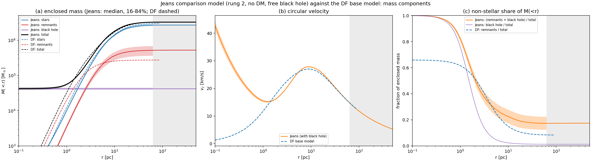
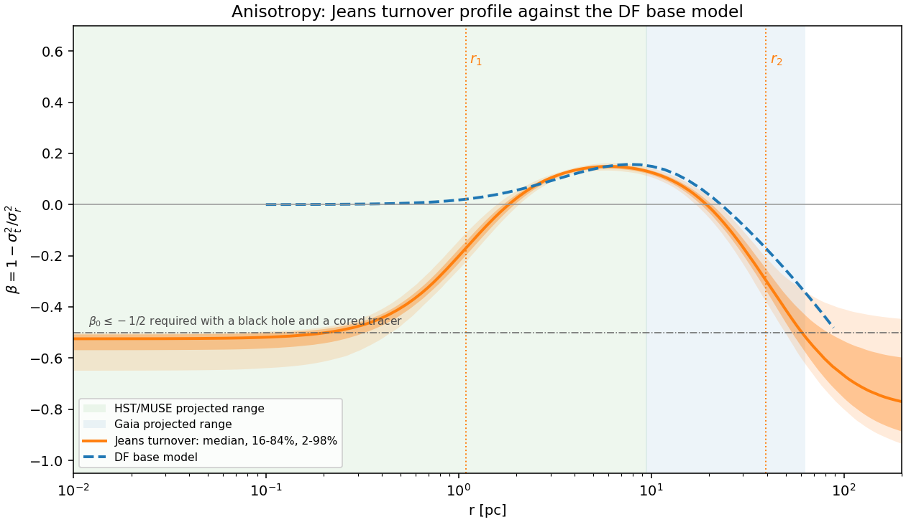
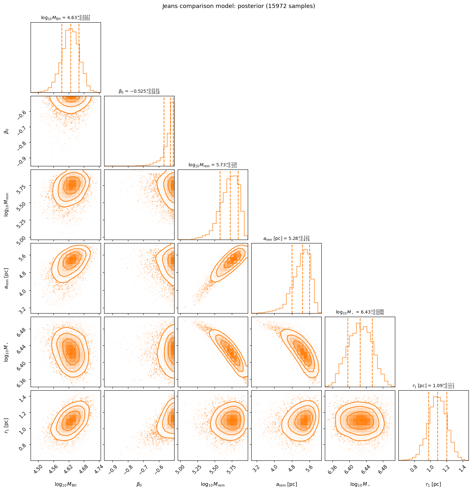
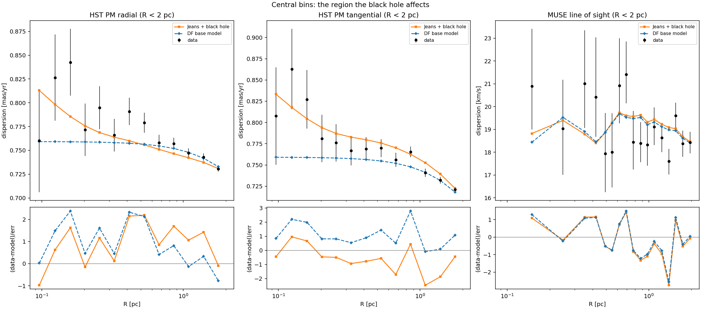
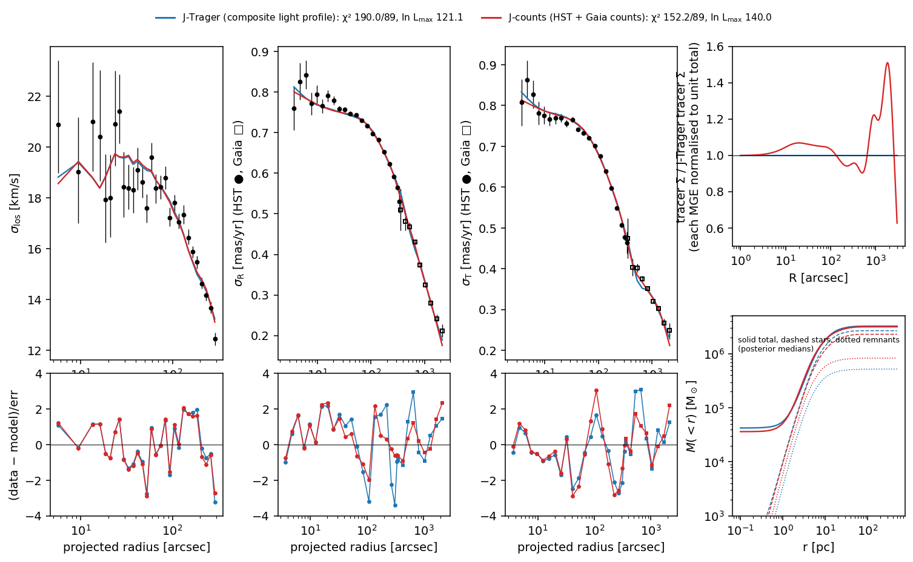
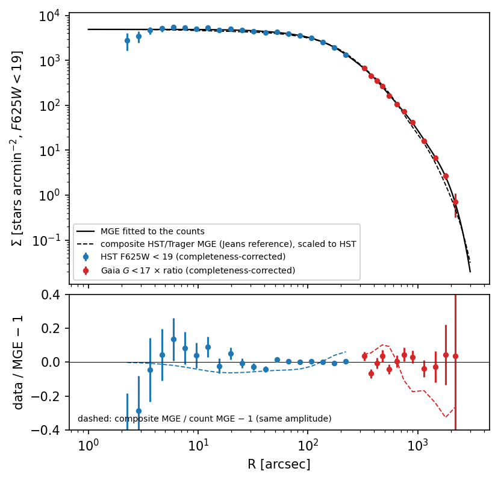
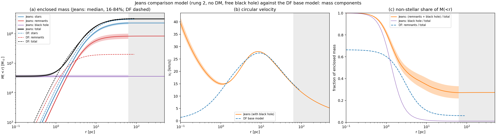
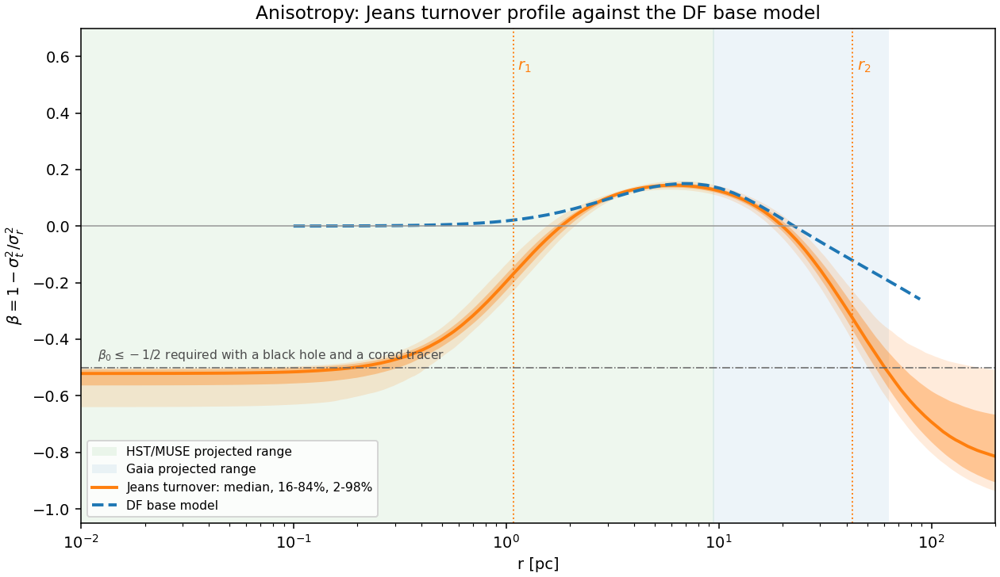
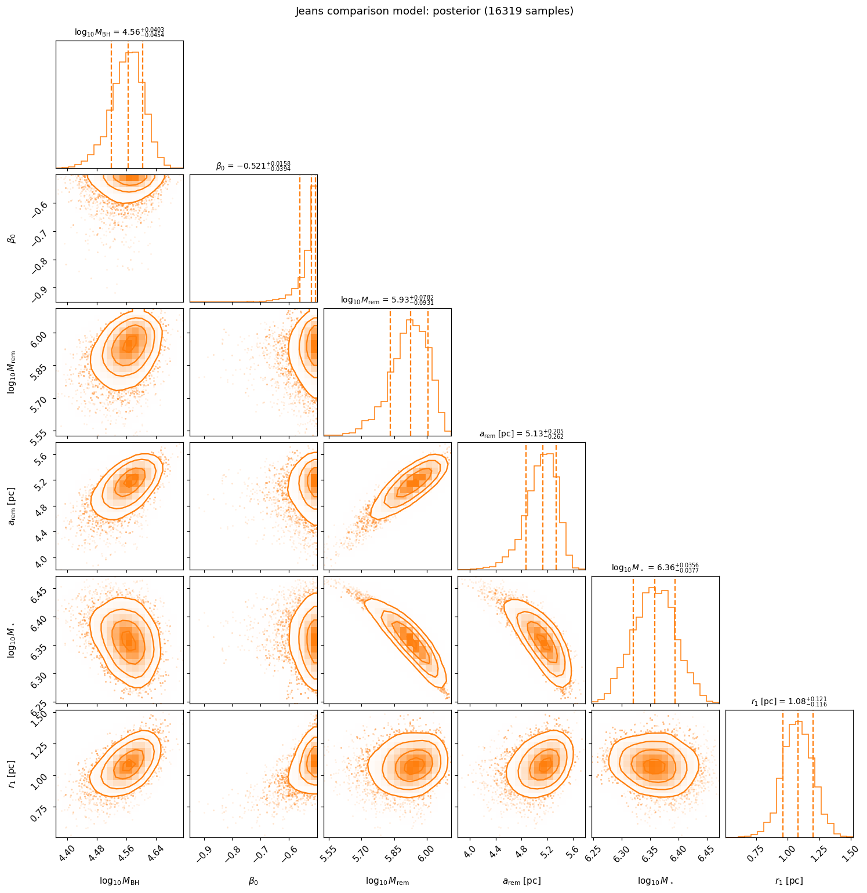
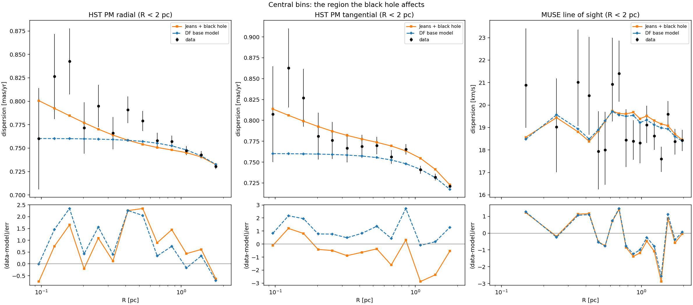

# Jeans comparison model: no dark matter, free black hole

The best model of the earlier [Jeans ladder](index.md#earlier-spherical-jeans-ladder-historical)
(rung 2, `results/fits/rung2_K1_turnover`). It is shown as the dashed curve in
the base-model figures and is the reference for the question of a central
black hole. It is fitted to the same 89-bin kinematic snapshot as the
[DF base model](base_no_dm.md), so the kinematic χ² of the two compare directly.

!!! info "Status"
    Completed 2026-09-21 (nested sampling, 15,972 posterior samples). Current:
    it uses the same 89-bin kinematic snapshot as the DF base model and its
    likelihood replays exactly; the 2026-10-13 count-likelihood fix does not
    apply to it, because it uses a fixed light profile as its tracer, not the
    star counts. Physically consistent outside the central ~0.2 pc; inside,
    the standard separable DF construction fails ([below](#physical-consistency)).

## Model definition

**Jeans equation.** For a spherical tracer of density \(\nu(r)\) in a mass
profile \(M(<r)\) with anisotropy \(\beta(r)\),

\[
\frac{d(\nu\sigma_r^2)}{dr}+\frac{2\beta}{r}\nu\sigma_r^2=-\nu\frac{GM(<r)}{r^2},
\qquad
\nu\sigma_r^2(r)=\frac{1}{g(r)}\int_r^\infty g(s)\,\nu(s)\frac{GM(<s)}{s^2}\,ds,
\]

with \(g(r)=\exp\left(2\int^r\beta/t\,dt\right)\). The line-of-sight and radial and
tangential proper-motion dispersions follow from the standard projection
integrals (Binney & Mamon 1982; van der Marel 1994) and are averaged over each
bin as for the DF. The published rotation is subtracted from the model's
second moments exactly as in the DF fit. Solver: `src/ocen_dm/kinematics/jeans.py`.

**Tracer.** Fixed, not fitted: an 11-component multi-Gaussian expansion of the
composite light profile (oMEGACat star counts inside 25″, Trager+1995 outside;
fit residual 0.18 mag rms), deprojected spherically.

**Mass components.**

| Component | Form | Parameters |
|---|---|---|
| Stars | mass follows the MGE light | \(M_\star\) |
| Remnants | Plummer sphere | \(M_{\rm rem}\), \(a_{\rm rem}\) |
| Black hole | point mass at the centre | \(M_{\rm BH}\) |
| Dark matter | none | — |

### How the stellar mass is determined

- **One stellar parameter, \(M_\star\):** the mass normalisation of the fixed
  light profile, i.e. the stellar mass-to-light ratio. The stellar density
  shape is the MGE and is not fitted.
- **The anisotropy parameters do not change the density.** They describe the
  stars' velocities only (unlike in the DF, where they also shape the density).
- **\(M_\star\) is set by the kinematics,** jointly with the remnants, the black
  hole and the anisotropy; it is not taken from photometry.
- **Mass-to-light ratio.** With L_V = 1.16×10⁶ L☉ (Harris V = 3.68,
  E(B−V) = 0.12, at the fitted distance), \(M_\star/L_V\) = 2.0 at maximum
  likelihood and 2.3 at the posterior median; \(M_{\rm tot}/L_V\) = 2.7–2.8,
  the same as the DF base model (2.8).

**Anisotropy ("turnover").** Three levels joined by two smooth transitions
(`src/ocen_dm/kinematics/anisotropy.py`):

\[
\beta(r)=\beta_0(1-f_1)+\beta_{\rm mid}(f_1-f_2)+\beta_\infty f_2,
\qquad f_i=\frac{r^2}{r^2+r_i^2},\quad r_2=r_1+\Delta r .
\]

The weights are non-negative and sum to one, so β never leaves the range of
its three levels.

## Parameters

| # | Parameter | Meaning | Prior | Posterior median (16–84%) | Maximum likelihood |
|---|---|---|---|---|---|
| 1 | \(M_{\rm BH}\) [M☉] | central black hole (point mass) | log-uniform 10²–3×10⁵ | 4.25 (3.92–4.58) ×10⁴ | 4.41×10⁴ |
| 2 | \(M_\star\) [M☉] | stellar mass (normalisation of the light profile, i.e. M/L) | log-uniform 10⁶–10⁷ | 2.66 (2.49–2.85) ×10⁶ | 2.37×10⁶ |
| 3 | \(M_{\rm rem}\) [M☉] | remnant (Plummer) mass | log-uniform 10⁴–3×10⁶ | 5.4 (3.8–7.0) ×10⁵ | 7.7×10⁵ |
| 4 | \(a_{\rm rem}\) [pc] | remnant Plummer scale | log-uniform 0.3–20 | 5.3 (4.8–5.6) | 5.7 |
| 5 | \(\beta_0\) | central anisotropy (<0 tangential; ≤ −½ required with a black hole) | uniform −1 to −0.5 | −0.53 (−0.57 to −0.51) | −0.50 |
| 6 | \(\beta_{\rm mid}\) | intermediate anisotropy level (>0 radial) | uniform −1 to 1 | 0.19 (0.18–0.21) | 0.20 |
| 7 | \(\beta_\infty\) | outer anisotropy level | uniform −1 to 1 | −0.81 (−0.94 to −0.63) | −0.98 |
| 8 | \(r_1\) [pc] | first anisotropy transition radius | log-uniform 0.05–30 | 1.09 (0.98–1.20) | 1.16 |
| 9 | \(\Delta r=r_2-r_1\) [pc] | gap to the second transition radius | log-uniform 0.5–150 | 38 (33–43) | 44 |
| 10 | D [kpc] | distance | normal 5.43 ± 0.05 | 5.36 (5.34–5.38) | 5.34 |

Fit: χ²_kin = 190.0 for 89 bins at maximum likelihood (DF base model: 156.4);
ln Z = 85.96. Sampler: UltraNest, 400 live points, Δln Z = 0.5, slice steps
2 × ndim, seed 42.

The upper bound of the β₀ prior is physical, not empirical: a cored tracer
around a point mass has a non-negative distribution function only if
β₀ ≤ −½ ([An & Evans 2006](https://arxiv.org/abs/astro-ph/0511686)). The
posterior piles up against that bound.

## Mass components



*(a) Enclosed mass by component (Jeans: posterior median and 16–84% from 300
saved draws; DF base model dashed). (b) Circular velocity. (c) Non-stellar
share of the enclosed mass. Grey: outside the radial range of the data.*

- **The black hole dominates the centre.** It holds more than half of the
  enclosed mass out to 1.3 pc; the stars and remnants inside 0.3 pc add only
  ~560 M☉. The circular velocity therefore rises towards the centre
  (Keplerian, 43 km/s at 0.1 pc), whereas in the DF model it falls to zero.
- **Beyond ~3 pc the two models agree** on the total mass to within a few per
  cent (Jeans 3.24×10⁶ M☉ in total, DF 3.26×10⁶) and on the circular-velocity
  peak (~27–28 km/s near 9 pc).
- **They split the non-stellar mass differently.** The Jeans model puts
  5×10⁵ M☉ in a Plummer of 5.3 pc plus the 4×10⁴ M☉ black hole; the DF
  puts 2.7×10⁵ M☉ in a Plummer of 2.2 pc. At 10 pc the non-stellar share is
  ~23% (Jeans) against 15% (DF).

**Physical plausibility of the remnant mass:** 18–26% of the total including the black hole, 1.5–2.9× the IMF budget for remnants heavier than the tracers; see [Remnant mass and the stellar population](../remnant_mass.md#our-models-against-these-bounds).

## Anisotropy



*β(r) of the Jeans model (posterior median, 16–84% and 2–98% from 3,000
draws; transition radii r₁ and r₂ dotted) against the DF base model (dashed).
Shaded: radial ranges of the HST/MUSE and Gaia data.*

- **Inside ~1 pc the models differ in sign.** The Jeans model is tangential
  (β ≈ −0.52 at the centre, −0.48 at 0.3 pc, −0.20 at 1 pc), as the black hole
  requires; the DF core is isotropic.
- **Between 3 and 15 pc they agree:** mildly radial, peaking at β ≈ +0.15.
- **Outside ~20 pc both turn tangential;** the Jeans model more strongly
  (−0.67 at 100 pc against −0.53), where only the Gaia data constrain it.

## Posterior and degeneracies



*Posterior of the black-hole mass and the parameters it trades against
(15,972 samples; dashed lines: 16, 50 and 84%).*

- **M_BH is well bounded within this model:** 4.25×10⁴ M☉, 95% interval
  3.6–4.9×10⁴; no posterior sample is below 10⁴ M☉.
- **β₀ is pinned at its bound** (−0.525, +0.019/−0.042), so the black-hole
  mass is measured conditional on the most radial central anisotropy the
  model allows.
- **M_BH correlates with the remnant scale and r₁** (correlation +0.53 and
  +0.51): a more extended remnant component or a larger tangential core needs
  a heavier black hole.
- **The leading degeneracy is stars against remnants** (M_rem–M★ −0.95,
  M_rem–a_rem +0.94), the same stars-versus-dark-mass trade seen in the DF fits.

## Central bins



*Bins inside 2 pc: HST radial and tangential proper-motion dispersions and
MUSE line-of-sight dispersions, with the Jeans (solid) and DF (dashed)
predictions and residuals.*

| Data inside 2 pc | Bins | χ² Jeans | χ² DF |
|---|---|---|---|
| HST PM radial | 13 | 21.5 | 22.3 |
| HST PM tangential | 13 | 16.7 | 23.1 |
| MUSE line of sight | 17 | 20.8 | 19.4 |
| **Total** | 43 | **59.0** | **64.8** |

- **The black hole gains Δχ² ≈ 6 in the central 43 bins,** almost entirely
  from the tangential proper motions inside 0.3 pc, where the data rise to
  0.81–0.86 mas/yr and the DF stays at 0.76.
- **It overshoots the tangential dispersions at 0.4–1.4 pc** (residuals −1 to
  −2.5σ), and the MUSE dispersions do not discriminate.
- **Over all 89 bins the DF fits better by Δχ² = 34,** mostly at 2–20 pc; see
  [Comparison with the Jeans model](base_no_dm.md#comparison-with-the-jeans-model-dashed-curves).

## Physical consistency

Checks from the [DF consistency audit](../../DF_CONSISTENCY_AUDIT.md), which
tests necessary conditions for a non-negative stellar distribution function
(passing them is not a proof that one exists):

| Check | Result |
|---|---|
| Spatial density of every component | non-negative everywhere |
| Central condition with a black hole and a cored tracer, β₀ ≤ −½ | met (enforced by the prior; β₀ = −0.503) |
| Separable DF, first derivative (B₁) | passes everywhere |
| Separable DF, radial condition (R₂) | passes everywhere |
| Separable DF, second derivative (B₂) | fails at 0.02–0.18 pc (minimum −0.11 at 0.12 pc); 89.7% of posterior draws fail in the same region |

- **Outside the central ~0.2 pc no failure is found.**
- **Inside it, the standard separable construction gives no non-negative DF.**
  A non-separable DF with the same density and dispersions is not excluded,
  so the model is not shown to be unphysical there, only not shown to be
  physical.
- **That region is where the black hole dominates** the mass and where its
  evidence comes from (the central bins above), which is why the result
  matters for the black-hole question.
- The DF base model is non-negative by construction.

## What this model says about a black hole

Within the Jeans framework the central rise of the HST proper-motion
dispersions is fitted by a 4×10⁴ M☉ point mass with tangential central orbits.
The evidence is local (Δχ² ≈ 6 from a few bins inside 0.3 pc), it depends on
an anisotropy forced to its physical limit, and in the central ~0.2 pc,
where the black hole acts, the standard separable construction of a
non-negative distribution function fails. Alternatives that are not
yet tested in the DF framework are a point mass with a self-consistent
DF, radially biased orbits in the core, and mass segregation of the
remnants.

## Twin model with the star-count tracer (J-counts, 2026-10-16)

This model is identical to the one above (call it **J-Trager**) except for its tracer: the same 89 bins, 10 parameters, priors and sampler (400 live points). Only the multi-Gaussian expansion (MGE) is replaced. It was fitted to the completeness-corrected HST (2–250″) and Gaia (300–2400″) star counts, with their amplitude ratio tied to the measured value ([count ratio](../data/cluster.md#gaia-completeness-from-the-hst-large-programme-fields-2026-10-16)). The MGE fits both count sets: HST deviance 20.5 over 20 bins, Gaia 13.5 over 12. Run: `results/fits/jeans_K1_turnover_counts_c`.



*Kinematic data with each model's best fit, and residuals, for line-of-sight dispersion, radial PM (HST ●, Gaia □) and tangential PM. Top right: the two tracer profiles, J-counts divided by J-Trager. Bottom right: enclosed mass (posterior medians).*

*Scripts: `bin/fit_count_tracer_mge.py`, `bin/run_jeans_counts_tracer.py`, `bin/plot_jeans_tracer_twins.py`.*



*The count tracer. Top: the completeness-corrected HST counts, and the Gaia counts times the fitted ratio, with the 12-Gaussian MGE (solid). Dashed: the composite (Trager) MGE of J-Trager, scaled to the HST counts. Bottom: data / MGE − 1. Dashed: composite MGE / count MGE − 1.*

**J-counts posterior.** These figures come from the same script as for J-Trager. Here the DF comparison is the [tied DF refit](base_no_dm.md#refit-with-completeness-corrected-counts-and-tied-amplitudes-2026-10-16), not the base fit.









*Script: `bin/plot_jeans_comparison_model.py --name jeans_K1_turnover_counts_c --jeans results/fits/jeans_K1_turnover_counts_c --df results/df/dftie_restart_20261016::observed_no_halo_start0`.*

| Quantity | J-Trager | J-counts |
|---|---|---|
| χ² of the best fit (89 bins) | 190.0 | **152.2** |
| HST PM radial / tangential (21 + 21 bins) | 61.8 / 36.6 | 30.5 / 50.1 |
| MUSE LOS (29) | 51.7 | 49.8 |
| Gaia PM radial / tangential (9 + 9) | 16.9 / 23.0 | 10.7 / 11.2 |
| ln L<sub>max</sub>; ln Z | 121.1; 86.0 ± 0.3 | 140.0; 103.9 ± 0.5 |
| M<sub>★</sub> | 2.67 (2.49–2.85)×10⁶ | 2.28 (2.09–2.48)×10⁶ |
| M<sub>rem</sub>; a<sub>rem</sub> | 5.4 (3.8–7.0)×10⁵; 5.28 pc | 8.4 (6.8–10.1)×10⁵; 5.13 pc |
| M<sub>BH</sub> | 4.25 (3.92–4.58)×10⁴ | 3.67 (3.30–4.02)×10⁴ |
| β<sub>0</sub>, β<sub>mid</sub>, β<sub>∞</sub> | −0.53, 0.19, −0.81 | −0.52, 0.19, −0.86 |
| D | 5.361 kpc | 5.362 kpc |

Ranges are 16th–84th percentiles; the other values are posterior medians.

- **The tracers differ by 5–50 %.** Relative to J-Trager, the count tracer is up to 7 % higher at 10–100″ and 5–10 % lower at 200–600″. Beyond 1000″ it is up to 50 % higher; there the Trager profile has no data and the MGE is an extrapolation.
- **The kinematic fit improves by Δχ² = −38 with the same number of parameters.** The gain comes from the HST radial PMs at 100–400″ (−31) and both Gaia PM components (−18). It is partly offset by the HST tangential PMs (+13). The kinematic curves differ only slightly (see the residual panels). The kinematics are fitted at a level comparable to the DF base model (χ² 156–159).
- **The mass split shifts, but the total hardly changes.** M<sub>★</sub> falls by 15 % and M<sub>rem</sub> rises by 57 %; the total is 3.16×10⁶ against 3.25×10⁶ M<sub>⊙</sub>.
- **M<sub>BH</sub> moves down by 14 %** (1.3 posterior σ), and is still non-zero at high significance.
- **Caveat on the evidence.** Δln Z = +18 between the two tracers is not a model comparison: the tracers are fixed inputs taken from different data, not fitted parameters.

## Reproduce

```bash
source <venv>/bin/activate
export PYTHONPATH=src
python bin/run_rung2_fits.py launch results/launches/<new_batch> --profile turnover   # rung-2 batch driver; fresh batch directory
python bin/plot_jeans_comparison_model.py --name rung2_K1_turnover \
  --jeans results/fits/rung2_K1_turnover \
  --df results/df/dftwo_counts_area_20261013::observed_no_halo_start3
```

The figures need only the saved run (posterior, profile draws) and the DF
base model, rebuilt once (~1 min on one core). Numbers plotted:
`results/plot_data/jeans_rung2_K1_turnover.json`.
