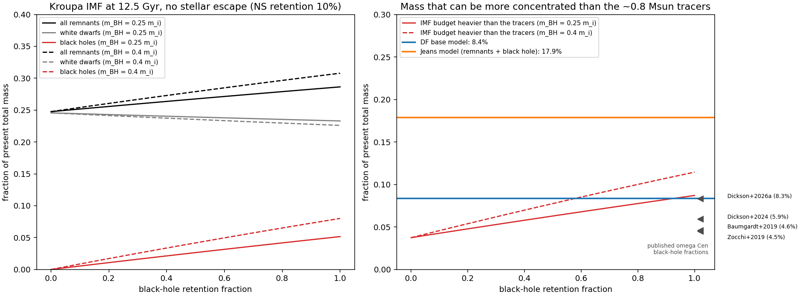

# Remnant mass and the stellar population

How much mass can be in stellar remnants (white dwarfs, neutron stars,
stellar-mass black holes), how it is tied to the stellar mass through the
initial mass function (IMF), and whether the remnant components of our two
models are physically sensible.

!!! abstract "Summary"
    - **The remnant mass is tied to the stellar mass** through the IMF, the
      initial–final mass relation, natal-kick retention and the cluster's
      escape history. For a Kroupa IMF at 12.5 Gyr, remnants are 25–31% of
      the present mass (white dwarfs 23–25%, black holes 0–8%, neutron stars
      < 1%); dynamical loss of low-mass stars raises this to ~50% in published
      fits of omega Cen.
    - **Our "remnant" component is not the total remnant mass.** Most white
      dwarfs (mean 0.59 M☉) are lighter than the ~0.8 M☉ stars that trace the
      light, are no more concentrated than them, and sit in the light-following
      stellar mass. The extra Plummer component can only represent mass *more*
      concentrated than the tracers: black holes, neutron stars and white
      dwarfs heavier than 0.8 M☉.
    - **That budget is 8.7–11.8% of the total mass** for a Kroupa IMF with all
      black holes retained, against published omega Cen black-hole fractions of
      4.5–6% (up to ~8% in 2026 preprints).
    - **The DF model passes** (best fit 8.4% of the total, M_rem/M★ = 0.09;
      tied, completeness-corrected refit 6.1%, 0.065); **the Jeans
      model does not** (18–26% including its black hole, M_rem/M★ ≈ 0.2;
      28–32% with the star-count tracer, J-counts): its
      component is too massive to be remnants and more plausibly absorbs a
      radial M/L variation.
    - **M_rem is weakly constrained.** The tied refit lowers it from 2.73 to
      2.00×10⁵ M☉ with predictions that change by a few per cent; J-counts
      puts 8.4×10⁵ M☉ (posterior median) in remnants.
    - **Proposed priors** (not adopted; a model change needs a decision):
      M_rem/M★ ~ HalfNormal(0.10) truncated at 0.30, and a remnant scale below
      the stellar half-mass radius.

## The bookkeeping

The cluster mass is living stars plus remnants,
\(M_{\rm cl}=M_{\rm live}+M_R\), with \(M_R=M_{\rm WD}+M_{\rm NS}+M_{\rm BH}\).
Our models decompose it differently:

\[
\rho_{\rm tot}(r)=M_\star\,\hat\rho_L(r)+M_{\rm rem}\,\hat\rho_P(r)\;[+M_\bullet\,\delta(\mathbf r)],
\]

where \(\hat\rho_L\) follows the counted light and \(\hat\rho_P\) is a Plummer
sphere. \(M_\star\) contains every remnant that is distributed like the light;
\(M_{\rm rem}\) is the mass the light-following profile cannot accommodate.
Hence \(M_{\rm rem}\neq M_R\): a prior on all remnants applied to
\(M_{\rm rem}\) would double-count. Bañares-Hernández+2025 make the same
distinction (their photometric mass includes remnants traced by the light).

Both are tied to the IMF through a shared normalisation,

\[
M_i=A\int\xi(m)\,m_{i,\rm final}(m,Z)\,P_{i,\rm bound}(m,t)\,dm,
\qquad
M_{\rm live}=A\int_{m<m_{\rm TO}}\xi(m)\,m\,P_{\rm bound}(m,t)\,dm,
\]

so the remnant mass cannot be chosen independently of the stars unless the
formation and escape history is also allowed to change.

## The IMF budget

Assumptions: Kroupa IMF (0.08–100 M☉), turnoff 0.79 M☉ (our MIST fit),
white dwarfs from 0.79–8 M☉ with \(m_{\rm WD}=0.109\,m_i+0.394\)
([Kalirai+2008](https://ui.adsabs.harvard.edu/abs/2008ApJ...676..594K)),
neutron stars of 1.3 M☉ from 8–20 M☉, black holes from > 20 M☉ with
\(m_{\rm BH}=f\,m_i\) capped at 40 M☉ (f = 0.25 or 0.4 for low metallicity),
and **no escape of stars**. Script: `bin/remnant_budget.py`.

| Retention (NS, BH) | m_BH = f m_i | Stars | White dwarfs | Neutron stars | Black holes | All remnants | Heavier than the tracers |
|---|---|---|---|---|---|---|---|
| 10%, 0% | — | 75.2% | 24.6% | 0.2% | 0% | 24.8% | 3.7% |
| 10%, 50% | 0.25 | 73.3% | 23.9% | 0.2% | 2.6% | 26.7% | 6.3% |
| 10%, 100% | 0.25 | 71.4% | 23.3% | 0.2% | 5.2% | 28.6% | 8.7% |
| 10%, 100% | 0.4 | 69.2% | 22.6% | 0.2% | 8.0% | 30.8% | 11.4% |
| 30%, 100% | 0.4 | 69.0% | 22.5% | 0.5% | 8.0% | 31.0% | 11.8% |

The mean white-dwarf mass is 0.59 M☉; white dwarfs heavier than 0.8 M☉
(progenitors > 3.7 M☉) are 3.3–3.5% of the total. The "heavier than the
tracers" column is black holes + neutron stars + those heavy white dwarfs.

[Dickson+2023](https://ui.adsabs.harvard.edu/abs/2023MNRAS.522.5320D) state
that white dwarfs contribute ~30% of the total mass at ~10 Gyr for a
canonical IMF, consistent with this calculation; a Codex calculation with a
fixed 15 M☉ black-hole mass gives 25–40% for all remnants.

*Left: present-day mass fractions of all remnants, white dwarfs and black
holes against the black-hole retention fraction (Kroupa IMF, 12.5 Gyr,
neutron-star retention 10%, no stellar escape). Right: the mass that can be
more concentrated than the ~0.8 M☉ tracers, against the fractions our models
need (horizontal lines) and the published omega Cen black-hole fractions
(arrows).*

## Which remnants can be more concentrated than the light

Mass segregation sorts objects by individual mass. The stars that trace the
light in our data (F625W < 19 HST counts, G < 17 Gaia counts) are turnoff and
giant stars of ~0.8 M☉. A typical white dwarf of 0.55–0.6 M☉ is heavier than
a low-mass main-sequence star but lighter than these tracers, so after
relaxation it should be less concentrated than the light, not more. Young
white dwarfs have been observed diffusing outward in 47 Tuc
([Heyl+2015](https://ui.adsabs.harvard.edu/abs/2015ApJ...804...53H)). In
omega Cen the white-dwarf sequence is split, interpreted with ~0.55 M☉
normal-population and ~0.46 M☉ helium-rich-population white dwarfs
([Bellini+2013](https://ui.adsabs.harvard.edu/abs/2013ApJ...769L..32B)).

The component that can sit inside the light is therefore black holes,
neutron stars and the heavy tail of white dwarfs. A large *total* white-dwarf
budget does not justify a large compact component on top of the light.

## Retention and dynamical evolution

**Natal kicks.** Young pulsars have a Maxwellian kick distribution with a
one-dimensional dispersion of 265 km/s
([Hobbs+2005](https://ui.adsabs.harvard.edu/abs/2005MNRAS.360..974H)). For a
remnant born at rest in a cluster with escape speed \(v_{\rm esc}\), the
retained fraction is

\[
P_{\rm ret}={\rm erf}\!\left(\frac{v_{\rm esc}}{\sqrt2\,\sigma_k}\right)
-\sqrt{\frac{2}{\pi}}\frac{v_{\rm esc}}{\sigma_k}\,e^{-v_{\rm esc}^2/2\sigma_k^2},
\]

which gives 0.3–3.6% for σ_k = 265 km/s and v_esc = 60–140 km/s (omega Cen's
present central escape speed is 63 km/s,
[Baumgardt+2019](https://ui.adsabs.harvard.edu/abs/2019MNRAS.488.5340B);
it was higher in the past). Standard kicks retain few neutron stars in
massive clusters: even forming neutron stars in binaries retains ~5% in the
standard model of [Pfahl+2002](https://ui.adsabs.harvard.edu/abs/2002ApJ...573..283P)
(1–8% across their parameters), which motivates low-kick channels; many
models adopt 10% (e.g. Hénault-Brunet+2020 for 47 Tuc). Black-hole kicks are
reduced by fallback, which depends on the explosion mechanism and metallicity
([Fryer+2012](https://ui.adsabs.harvard.edu/abs/2012ApJ...749...91F)).

**Dynamical evolution changes the fractions in both directions.**

- Preferential escape of low-mass stars raises the remnant fraction without
  adding remnant mass: dissolving clusters become remnant-dominated
  ([Baumgardt & Makino 2003](https://ui.adsabs.harvard.edu/abs/2003MNRAS.340..227B));
  present-day mass functions correlate with relaxation time and dark-remnant
  fraction ([Sollima & Baumgardt 2017](https://ui.adsabs.harvard.edu/abs/2017MNRAS.471.3668S),
  [Baumgardt & Sollima 2017](https://ui.adsabs.harvard.edu/abs/2017MNRAS.472..744B)).
- A retained black-hole subsystem heats the cluster and changes which objects
  escape ([Breen & Heggie 2013](https://ui.adsabs.harvard.edu/abs/2013MNRAS.432.2779B)).
  Dynamical masses of Milky Way globular clusters exceed their stellar masses
  by more than a factor of 2, which N-body models reproduce only with low
  black-hole natal kicks
  ([Rostami-Shirazi+2025](https://ui.adsabs.harvard.edu/abs/2025MNRAS.536.1332R)).
- Black-hole fractions can grow large: Palomar 5 may hold ~20% of its present
  mass in black holes after losing most of its stars
  ([Gieles+2021](https://ui.adsabs.harvard.edu/abs/2021NatAs...5..957G)).
- Top-heavy IMFs raise remnant production but also early mass loss and
  disruption ([Haghi+2020](https://ui.adsabs.harvard.edu/abs/2020ApJ...904...43H));
  multimass fits favour high-mass IMF slopes compatible with canonical values
  ([Dickson+2023](https://ui.adsabs.harvard.edu/abs/2023MNRAS.522.5320D)).

The remnant fraction is therefore not arbitrary at fixed IMF, stellar
normalisation and history, but there is no history-independent ceiling well
below unity.

## Omega Cen: published remnant content

| Study | Method | Remnant content |
|---|---|---|
| [Zocchi+2019](https://ui.adsabs.harvard.edu/abs/2019MNRAS.482.4713Z) | two-component limepy (black holes vs other stars and remnants) | black holes 4.5 (+4.0/−2.5)%, 1.35×10⁵ M☉ (Table 2) |
| [Baumgardt+2019](https://ui.adsabs.harvard.edu/abs/2019MNRAS.488.5340B) | N-body grid, IMF and stellar evolution supply the remnants | black holes 4.6 ± 0.5%, 1.65×10⁵ M☉; compatible with stellar-evolution predictions |
| [Dickson+2024](https://ui.adsabs.harvard.edu/abs/2024MNRAS.529..331D) | multimass limepy with IMF, IFMR and retention | black holes 5.9 ± 0.2%, 1.82×10⁵ M☉ (12,400 black holes); **all dark remnants 50.3%** (Table 1; statistical errors only) |
| [Dickson+2026a](https://ui.adsabs.harvard.edu/abs/2026arXiv260707010D) (preprint) | multimass models coupled to cluster evolution | black holes ~8.3%; omega Cen is excluded from their sample relations as an outlier |
| [Dickson+2026b](https://ui.adsabs.harvard.edu/abs/2026arXiv260910955D) (preprint) | as above, several black-hole prescriptions | black holes ≳ 7% under each prescription |
| [Bañares-Hernández+2025](https://ui.adsabs.harvard.edu/abs/2025A%26A...693A.104B) | Jeans + pulsar accelerations; extra component on top of the light | 2.65×10⁵ M☉ in a 1.88 pc Plummer (9.0%) |
| [Evans+2022](https://ui.adsabs.harvard.edu/abs/2022MNRAS.511.4251E) | axisymmetric Jeans | a compact remnant core can supply up to ~5×10⁵ M☉ (model-based, not a universal limit) |

A stellar-mass black-hole binary has been detected directly
([Whitaker+2026](https://ui.adsabs.harvard.edu/abs/2026ApJ..1006L...1W)),
which establishes that black holes exist in the cluster, not their total
mass. For comparison, 47 Tuc holds only 430 (+386/−301) M☉ in black holes
([Hénault-Brunet+2020](https://ui.adsabs.harvard.edu/abs/2020MNRAS.491..113H))
while its multimass models favour a large white-dwarf population
(Dickson+2024): a small black-hole fraction does not mean little remnant mass.

**How models treat remnants.** Multimass equilibrium models (limepy;
validated against N-body by
[Peuten+2017](https://ui.adsabs.harvard.edu/abs/2017MNRAS.470.2736P)) need
component masses supplied by a population model: Hénault-Brunet+2020 and
Dickson+2023/2024 derive them from fitted mass-function slopes, an IFMR and
retention, with segregation tied to object mass. N-body grids (Baumgardt+2019)
and Monte Carlo models ([Kremer+2020](https://ui.adsabs.harvard.edu/abs/2020ApJS..247...48K))
generate them from the IMF and stellar evolution. Zocchi+2019 and
Bañares-Hernández+2025 instead fit the dark component's mass and check it
against population expectations, as our models do.

## Our models against these bounds

| | DF base model (best fit) | Jeans comparison model (J-Trager) |
|---|---|---|
| Extra component | Plummer, 2.73×10⁵ M☉, a = 2.18 pc | Plummer 5.4×10⁵ M☉, a = 5.3 pc, + black hole 4.25×10⁴ M☉ (posterior medians) |
| q = M_rem/M★ (Jeans: including the black hole) | 0.09 | 0.22 (median) to 0.34 (maximum likelihood) |
| Fraction of the total | 8.4% | 17.9% (median), 25.5% (maximum likelihood) |
| Remnant half-mass radius / stellar half-mass radius (10.4 pc) | 0.27 | 0.66 |
| Against the IMF budget heavier than the tracers (8.7–11.8%) | inside, at high black-hole retention | 1.5–2.9× above |
| Against published black-hole fractions (4.5–8.3%) | 1.0–1.9× (consistent once heavy white dwarfs and neutron stars, ~3–4%, are added) | 2–6× |
| Verdict | physically sensible as black holes + neutron stars + heavy white dwarfs | not plausible as remnants alone; more likely absorbs a radial M/L trend of its fixed light profile |

**The other fits.** The tied, completeness-corrected DF refit (best fit
2.00×10⁵ M☉, a = 1.88 pc) has q = 0.065 and 6.1% of the total (3.28×10⁶ M☉),
inside the IMF budget and the published black-hole fractions. The Jeans twin
with the star-count tracer (J-counts) has 8.4×10⁵ M☉ in remnants plus a
3.67×10⁴ M☉ black hole (posterior medians): 27.9% of the total, q = 0.39
(32.2% and 0.47 at maximum likelihood), further above the budget than
J-Trager. Across these four fits M_rem ranges from 2.0 to 8.4×10⁵ M☉ with
χ²_kin between 152 and 190, so it is weakly constrained.

The Jeans model's remnant mass would require strong preferential loss of
low-mass stars on top of full black-hole retention. Its broad 5.3 pc scale
also suggests it is compensating for the fixed light-profile tracer, which
our own mass-function measurement shows is not mass-follows-light (the mass
per bright star rises outward).

## Proposed priors

From the Codex research pass (regularising, not published limits) and the
IMF budget above. Not adopted: changing the priors changes the model.

| Quantity | Prior | Reasoning |
|---|---|---|
| \(q=M_{\rm rem}/M_\star\) | HalfNormal(σ = 0.10), truncated at 0.30 | 95% below q ≈ 0.19; favours the literature scale, keeps a tail |
| IMF-tied alternative | q ≲ 0.13 (≲ 0.2 allowing for stellar depletion) | heavier-than-tracer budget for a Kroupa IMF with full black-hole retention |
| \(x=a_{\rm rem}/r_{h,\star}\) | ln x ~ N(ln 0.3, 0.8²), 0.03 < x < 0.77 | remnant half-mass radius below the stellar one; black-hole subsystems need not be extremely compact (Breen & Heggie 2013) |
| Total remnant fraction (if modelled separately) | f_R ~ N(0.40, 0.12²), 0.15–0.70 | must apply to embedded plus extra remnants together |

Both models' scales satisfy the scale prior. The DF mass (q = 0.09) sits
near the centre of the mass prior; the Jeans mass (q ≈ 0.2) is in its tail.

The physically consistent alternative is a multimass model in which the
remnant inventory and its radial distribution are predicted from the IMF,
the IFMR, retention and depletion, normalised to the star counts, instead of
a free Plummer added to a single light-following component.

## Open points

- A black-hole subsystem and an IMBH are not mutually exclusive: the
  fast-moving stars require a point mass ≥ 8,200 M☉
  ([Häberle+2024](https://ui.adsabs.harvard.edu/abs/2024Natur.631..285H)),
  and an IMBH of ~5×10⁴ M☉ can grow in evolutionary models of omega Cen
  ([González Prieto+2025](https://ui.adsabs.harvard.edu/abs/2025ApJ...990L..69G)).
- The Dickson+2026 values are preprints.
- Our extra component's mass trades against M★ (±23% on mocks); a q-prior
  constrains that trade but does not remove it.

Sources: the papers linked above (all in the
[SciX library](literature.md)); Codex research pass
[2026-10-15](../reviews/codex_remnant_priors_2026-10-15.md); comparison of
remnant masses and scales with published fits:
[Remnant mass and spatial scale](literature_comparison.md#remnant-mass-and-spatial-scale).
